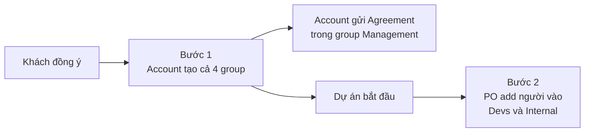

# Lập 4 group chat khi có khách hàng mới

**Người chịu trách nhiệm:** Account
**Cập nhật lần cuối:** 2026-10-22
**Trạng thái:** Nháp

## Tại sao có trang này

Nếu mỗi group được mở vào một lúc khác nhau, tuỳ người nhớ, thì sẽ có lúc khách cần hỏi về hoá đơn mà group Management chưa có. Khách sẽ hỏi ở group nào đang có sẵn, thường là group của dev. Từ giờ Account tạo cả 4 group trong một lần khi khách đồng ý, còn PO add người khi dự án bắt đầu.

| Group | Dùng để | Nền tảng | Ngôn ngữ |
|-------|---------|----------|----------|
| Broker | Làm việc với broker: gửi sale-kit, bàn deal và thoả thuận | Telegram, hoặc WhatsApp nếu broker yêu cầu | Tiếng Anh |
| Management | Account gửi Agreement, hoá đơn và xử lý việc account. Broker cũng ở đây để thấy giấy tờ như khách | Telegram, hoặc WhatsApp nếu khách yêu cầu | Tiếng Anh |
| Devs | Làm việc dự án hằng ngày với khách | Telegram, hoặc WhatsApp nếu khách yêu cầu | Tiếng Anh |
| Internal | Team trao đổi với nhau mà không làm phiền khách. Nói chuyện thoải mái được | Chỉ Telegram | Tiếng Việt |

## Khi nào áp dụng (Trigger)

- Khách đồng ý: làm bước 1, tạo cả 4 group.
- Dự án bắt đầu: làm bước 2, add người vào Devs và Internal.

---

## Luồng chính

---

## Vai trò & trách nhiệm

| Vai trò | Chịu trách nhiệm gì |
|---------|---------------------|
| Account | Tạo cả 4 group, chuyển quyền owner cho Anderson, add COO làm admin. Gửi Agreement trong group Management sau bước 1 |
| Anderson | Owner của cả 4 group. Quyết broker có vào group Devs hay không |
| COO | Có mặt và làm admin ở Devs và Internal. Không có việc phải làm trong quy trình này |
| Product Owner | Add team và người phía khách vào Devs và Internal ở bước 2. Gửi tin chào khách |

---

## Quy tắc đặt tên group

| Group | Tên | Ví dụ |
|-------|-----|-------|
| Broker | `Cyberk - BROKER_NAME` | `Cyberk - Andre` |
| Management | `PROJECT_NAME - Cyberk Management` | `Leaseform - Cyberk Management` |
| Devs | `PROJECT_NAME - Cyberk devs` | `Leaseform - Cyberk devs` |
| Internal | `PROJECT_NAME - Cyberk Internal` | `Leaseform - Cyberk Internal` |

`BROKER_NAME` là tên broker. Nếu làm việc với một công ty broker thì dùng tên công ty.

`PROJECT_NAME` là tên dự án, viết giống tên board `[project-name]-management` trên GitHub Projects, viết hoa chữ cái đầu.

Giữa hai phần là dấu gạch ngang, mỗi bên một khoảng trắng. Phần đuôi `Cyberk devs`, `Cyberk Internal`, `Cyberk Management` giữ nguyên, không dịch và không viết tắt. Tên group không có emoji, ngày tháng hay tên người.

Ví dụ tên sai:

| Tên sai | Sai ở đâu |
|---------|-----------|
| `Leaseform Dev Team` | Thiếu ` - Cyberk` và đổi phần đuôi, nên search "Cyberk devs" không ra |
| `LF - Cyberk devs` | Viết tắt tên dự án, không khớp tên board |
| `🚀 Leaseform x Cyberk 2026` | Có emoji và năm, dùng `x` thay cho ` - `, không biết là group nào trong 4 group |
| `Cyberk Internal - Leaseform` | Đảo thứ tự, nên trong danh sách chat group này không nằm cạnh các group khác của dự án |

Khi tên đúng, gõ tên dự án vào ô search của Telegram sẽ ra đủ 3 group của dự án, còn gõ `Cyberk devs` sẽ ra mọi group đang làm việc với khách. Lệch một ký tự là group đó không hiện trong kết quả search, và người cần add có thể bị sót.

---

## Các bước

### Bước 1 — Tạo cả 4 group, khi khách đồng ý

Account tạo cả 4 group, đặt tên theo quy tắc ở trên, chuyển quyền owner cho Anderson, rồi add những người sau:

| Group | Add ở bước 1 |
|-------|--------------|
| `Cyberk - BROKER_NAME` | Broker, bot Neo. Broker đã có group thì dùng lại, không tạo mới |
| `PROJECT_NAME - Cyberk Management` | Account, người ra quyết định bên khách, broker, bot Neo |
| `PROJECT_NAME - Cyberk devs` | COO (admin), bot Smith |
| `PROJECT_NAME - Cyberk Internal` | COO (admin), bot Smith |

Sau bước này Account gửi Agreement trong group Management. Cách gửi sẽ nằm trong quy trình Account, hiện chưa viết.

### Bước 2 — Add người vào Devs và Internal, khi dự án bắt đầu

| Group | Add ở bước 2 | Ai add |
|-------|--------------|--------|
| Internal | PO, Developer, Designer, QA | PO |
| Devs | PO, Developer, Designer, QA, PO hoặc tech contact bên khách, broker nếu Anderson đồng ý | PO |

Người của Cyberk được add theo [Project Onboarding](../../04-developer/dev-project-onboarding/dev-project-onboarding-process.md). Add xong, PO gửi tin chào khách trong group Devs. Mẫu tin nhắn ở [chat-groups-example.md](chat-groups-example.md).

---

## Quy tắc cứng (không được vi phạm) + lý do

| Quy tắc | Lý do |
|---------|-------|
| Account tạo group và chuyển owner cho Anderson ngay sau khi tạo | Trên Telegram, người tạo group là owner. Chuyển về Anderson thì khi Account nghỉ việc, Cyberk vẫn giữ được group và lịch sử chat |
| Tạo cả 4 group trong một lần | Account không phải nhớ group nào mở lúc nào, và khách có group Management ngay để trao đổi về hợp đồng |
| Chỉ add team vào Devs và Internal khi dự án đã bắt đầu | Add sớm thì khách có thể nhắn vào group Devs trong lúc chưa ai được giao trả lời |
| Đặt tên theo [quy tắc đặt tên](#quy-tắc-đặt-tên-group) | Tên đúng thì search ra đủ group. Lý do chi tiết ở mục quy tắc đặt tên |
| Group Internal chỉ dùng Telegram | Khách không ở group này. Telegram là công cụ chat chuẩn của Cyberk, nên group nằm cùng chỗ với các group nội bộ khác |

---

## Ngoại lệ & Escalation

| Tình huống | Hành động |
|-----------|----------|
| Khách đến thẳng, không qua broker | Chỉ tạo 3 group: Management, Devs, Internal. Group Management không có broker |
| Khách hoặc broker yêu cầu WhatsApp | Mở group đó trên WhatsApp, giữ nguyên tên và thành viên. Group trên WhatsApp không có bot. Internal vẫn ở Telegram |
| Khách muốn dùng group hoặc công cụ chat của họ | Báo Anderson quyết. Group Internal vẫn tạo như bình thường |
| Account vắng mà cần tạo group gấp | Báo Anderson qua Telegram. Anderson chỉ định người tạo thay |
| Deal huỷ sau khi đã tạo group | Chưa có quy định. Account báo Anderson để quyết giữ hay giải tán group |
| Member rời dự án | Xoá khỏi group theo [Project Leave](../../05-product-owner/po-project-leave/po-project-leave-process.md) |

Trang này chưa mô tả việc bot Neo và Smith làm trong từng group.

---

## Liên kết

- [Project Onboarding — add member, PRD, GitHub repo](../../04-developer/dev-project-onboarding/dev-project-onboarding-process.md)
- [Cẩm nang đặt tên group và add đúng người](chat-groups-handbook.md)
- [Mẫu tin nhắn](chat-groups-example.md)
- [Kick-off dự án](../../05-product-owner/po-kick-off/kick-off-process.md)
