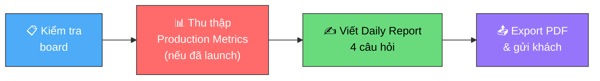

# Viết Daily Report

**Người chịu trách nhiệm:** PO / Product Owner
**Trạng thái:** Nháp

## Tại sao có trang này

Khách hàng quốc tế cần biết dự án đang ở đâu mỗi ngày. Daily report không chỉ là "báo cáo" — mà là công cụ để **phát hiện risk sớm, giữ tiến độ, và xây dựng niềm tin** với khách hàng. Report mơ hồ = khách lo lắng. Report cụ thể = khách yên tâm.

Daily Report nằm ở **đầu tab sprint** trong file Management, ngay trên bảng task. Mỗi ngày PO export tab này ra PDF và gửi khách, nên khách đọc report và nhìn thấy board trong cùng một trang.

## Khi nào áp dụng (Trigger)

Mỗi ngày làm việc, ở bước **CHANGE** của [Internal Daily](../../05-product-owner/po-internal-daily/internal-daily-process.md), ngay sau khi board đã cập nhật.

---

## Luồng chính

---

## Vai trò & trách nhiệm

| Vai trò | Chịu trách nhiệm gì |
|---------|---------------------|
| **Dev** | Cập nhật Status, Progress task của mình trên board đúng thực tế. Kể rõ mình đang kẹt ở đâu để PO viết vào phần vấn đề |
| **Tech Lead** | Kiểm tra board, đưa ra các giải pháp kỹ thuật cho từng vấn đề, review report |
| **PO / Leader** | Viết Daily Report từ board, export PDF, gửi khách hàng, escalate risk nếu cần. **Nếu dự án đã launch: cung cấp Production Metrics** (Users, Revenue, Bugs) |

---

## Các bước

| # | Việc | Ai | Đầu ra | Timeline |
|---|------|----|--------|----------|
| 1 | **Kiểm tra board:** rà soát tab sprint, đảm bảo Status (`Todo` / `Doing` / `Pending` / `Done`) và Progress phản ánh đúng thực tế. Task nằm ở `Doing` quá 2 ngày đã được bôi đỏ | Tech Lead / PO | Board chính xác | Trong buổi Internal Daily |
| 2 | **Thu thập Production Metrics** *(nếu đã launch)*: lấy snapshot Users (active/total/new), Business KPIs (revenue/transactions), Production Bugs (open/fixed/total) từ analytics tools | PO / Leader | Metrics sẵn sàng cho report | Trước khi viết report |
| 3 | **Viết Daily Report ở đầu tab sprint**, trả lời 4 câu hỏi: Team đã làm xong những gì? → Đang gặp vấn đề gì? → Có những giải pháp nào? → Chọn giải pháp nào, tại sao? Đã launch thì thêm Production Metrics ngay sau câu 1 | PO / Tech Lead | Daily Report hoàn chỉnh | Ngay sau khi board cập nhật |
| 4 | **Export PDF & gửi khách:** export tab sprint ra PDF, gửi vào group `[Project] - Cyberk devs` kèm tin nhắn summary 3–5 dòng | PO | Khách hàng nhận PDF + summary | Ngay sau khi viết xong |

---

## Quy tắc cứng

| Quy tắc | Lý do |
|---------|-------|
| **Viết cụ thể việc khách thấy được trên sản phẩm** | "Worked on frontend" không truy vết được. "Completed dashboard UI with dark mode" mới có giá trị |
| **Vấn đề hôm trước đã giải quyết → ghi ở câu 1. Chưa giải quyết → nêu lại ở câu 2** | Risk biến mất khỏi report không có nghĩa là biến mất khỏi dự án |
| **Mỗi vấn đề có ít nhất 2 giải pháp, mỗi giải pháp kèm cái giá** *(thời gian, chi phí, ảnh hưởng)* | Khách thấy được team đã cân nhắc gì, và tự đánh giá được |
| **Giải pháp đã chọn có lý do, người làm và ngày xong** | Không có ngày = không có cam kết = khách không biết khi nào hết vấn đề |
| **Vấn đề phụ thuộc khách hàng → ghi rõ khách cần làm gì** | VD: "Đang chờ Jon cung cấp Google Dev account" — PO cần biết để follow up |
| **Post-Launch: Production Metrics có số + nguồn** | "Users tăng" vô nghĩa. "1,250 active / 5,000 total (Firebase)" mới có giá trị |
| **Biến động bất thường → đưa vào câu 2** | Users giảm >20%, revenue drop, critical bugs tăng là vấn đề cần giải pháp, không chỉ là con số |

---

## Ngoại lệ & Escalation

| Tình huống | Hành động |
|-----------|----------|
| Risk **CRITICAL** — ảnh hưởng deadline dự án | Báo ngay cho Tech Lead + PO + **AM (Anderson / Brian)**, không chờ đến lúc viết report |
| Vấn đề kéo dài **> 2 ngày** mà chưa giải quyết | Bôi đỏ task trên board, ghi số ngày trong câu 2. PO escalate lên khách hàng |
| Không liên lạc được với khách hàng để unblock | Ghi rõ trong câu 2: "Không thể liên lạc [Tên], ảnh hưởng [gì]" |
| Vấn đề cần khách chọn giải pháp | Ở câu 4 ghi giải pháp team đề xuất và hạn khách cần trả lời |

---

## Checklist mỗi ngày

- [ ] Board đúng thực tế: Status, Progress đã cập nhật, task `Doing` quá 2 ngày đã bôi đỏ
- [ ] Production Metrics *(nếu đã launch)*: có Users, Business KPIs, Bugs — đều có số + nguồn data
- [ ] Câu 1: liệt kê cụ thể việc đã xong, có vấn đề hôm trước đã giải quyết
- [ ] Câu 2: vấn đề hôm trước chưa giải quyết đã nêu lại, biến động metrics bất thường đã ghi vào
- [ ] Câu 3: mỗi vấn đề có ít nhất 2 giải pháp, mỗi giải pháp có cái giá
- [ ] Câu 4: có giải pháp đã chọn, lý do, người làm, ngày xong
- [ ] Đã export PDF và gửi vào group kèm tin nhắn summary

---

## Liên kết

- [Cẩm nang Daily Report](daily-report-handbook.md) — Cách nghĩ khi viết từng câu
- [Mẫu Daily Report](daily-report-example.md) — Ví dụ chưa tốt / tốt, template trống
- [Internal Daily](../../05-product-owner/po-internal-daily/internal-daily-process.md) — Buổi họp mà Daily Report được viết ra
