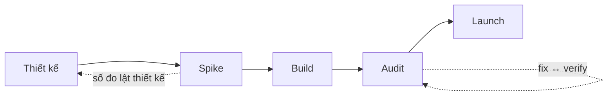

# Làm dự án Solana contract — Quy trình cho Lead, Dev, Reviewer

**Người chịu trách nhiệm:** Anderson (mặc định theo [owners-reference](../../02-about-handbook/owners-reference.md), chưa gán owner riêng)
**Cập nhật lần cuối:** 2026-11-19
**Trạng thái:** Nháp

## Tại sao có trang này

Bug trong contract làm mất tiền của user, và tiền đã mất thì không lấy lại được bằng một bản vá như bug web. Trên Solana còn thêm một điều: giới hạn của runtime (kích thước tx, số account, độ sâu CPI, compute unit, rent) quyết định hình dạng thiết kế, nên sai từ thiết kế thì phải viết lại. Trang này là các bước để **làm theo**, mỗi bước có tiêu chí "xong khi" rõ ràng. Kiến thức và lý do nằm ở [cẩm nang](./dev-solana-contract-handbook.md), các con số nằm ở [bảng giới hạn runtime](./solana-runtime-limits-reference.md).

**Phạm vi:** chỉ program on-chain. Frontend, indexer, RPC, cách đưa tx lên chain không thuộc trang này. Off-chain chỉ xuất hiện ở đầu ra bàn giao: IDL, client sinh tự động, runbook.

### Triết lý cốt lõi: Đo trước khi tin

> **Mọi claim kỹ thuật đều gắn một trong ba nhãn: `[V]` đã kiểm · `[ER]` suy luận · `[U]` chưa biết.**
> `[V]` phải kèm bằng chứng chạy lại được: tx, số đo, `file:dòng` tại một commit, hoặc kết quả RPC.

Tại sao?
- **Docs và trí nhớ sai nhiều hơn mình nghĩ.** Ở dự án Flux, bản fact-check trên giấy kết luận "swap dùng v0 + ALT"; gửi tx thật trên fork mainnet thì kết luận đảo thành tx v1.
- **Giới hạn runtime thay đổi.** Con số đúng năm ngoái có thể sai hôm nay, nên số nào cũng cần ngày kiểm.
- **Người sau biết chỗ nào còn mỏng.** Nhãn `[U]` là việc phải làm, không phải chỗ để trống.

## Khi nào áp dụng (Trigger)

- Bắt đầu một program Solana mới sẽ giữ tài sản hoặc quyền của user
- Thêm instruction mới hoặc đổi account model của program đã có
- Upgrade program đang chạy: đi lại từ Build đến Launch cho phần thay đổi. Launch lúc này là luồng upgrade qua multisig, xem [cẩm nang](./dev-solana-contract-handbook.md#upgrade-authority)

**Trước khi bắt đầu:** trang này giả định bạn đã biết account, PDA, CPI, ALT, IDL. Chưa làm Solana thì đọc [Core Concepts](https://solana.com/docs/core) và dùng skill `solana-dev` trước.

---

## Luồng chính

| Bước | Khẩu hiệu | Đầu ra chính |
|------|-----------|--------------|
| **Thiết kế** | Account trước, code sau | Doc thiết kế: account, PDA, bảng instruction × account, ai giữ quyền gì |
| **Spike** | Đo bằng tx thật, đừng tin docs | Báo cáo số đo, doc thiết kế đã sửa và qua review |
| **Build** | Mỗi instruction có test đường lỗi | Program, test 3 tầng (unit, fork, fuzz) |
| **Audit** | Người viết không tự duyệt | Báo cáo, bản fix, kết quả verify lại |
| **Launch** | Deploy đúng cái đã audit | Program đã verify, authority ở multisig, bộ bàn giao |

Hai vòng lặp: Spike quay lại Thiết kế khi số đo lật thiết kế; trong Audit thì fix ↔ verify lặp đến khi sạch.

### ⏱ Lưu ý về Timeline

> **Chưa chốt.** Chưa có số ngày hay tỷ lệ thời gian cho từng bước. Mỗi bước kết thúc theo tiêu chí "Xong khi", không theo lịch.

---

## Vai trò & trách nhiệm

| Vai trò | Chịu trách nhiệm gì |
|---------|---------------------|
| **Lead** | Chốt scope với owner dự án, giữ doc thiết kế, giao việc, review từng PR, triage finding, chọn commit pin, xác nhận "xong" cho từng bước |
| **Dev** | Làm spike, code, test, fix, build artifact, deploy theo runbook |
| **Reviewer** | Phản biện thiết kế, audit code tại commit pin, verify bản fix |
| **Owner dự án** | Chốt các quyết định về tin cậy (upgradeable hay bất biến, ai giữ quyền gì, time_lock) và chấp nhận rủi ro tồn đọng |

Một vai có thể do người hoặc AI session đảm nhận, và một người có thể giữ nhiều vai. Ngoại lệ duy nhất: Reviewer không review phần mình viết.

---

## Các bước

### Thiết kế

> *Account trước, code sau*

| # | Việc làm | Ai làm | Đầu ra | Bằng chứng cần lưu |
|---|----------|--------|--------|-------------------|
| 1.1 | Chốt scope và mô hình tin cậy: cái gì nằm on-chain, ai được upgrade / pause / đổi config, program upgradeable hay bất biến | Lead, Owner dự án chốt | Danh sách role và quyền | **Bảng quyết định**: mỗi dòng có lý do, người chốt, ngày |
| 1.2 | Thiết kế account model: có những account nào, seed PDA, kích thước, ai trả rent, ai được đóng | Lead + Dev | Bảng account | Lý do tách hoặc gộp account |
| 1.3 | Lập bảng instruction × account: account nào signer, writable; CPI sang program nào; PDA nào ký; event nào | Dev | Bảng instruction × account | — |
| 1.4 | Viết danh sách bất biến (invariant) và các giả định về runtime, program bên ngoài | Lead | Bất biến có đánh số, danh sách giả định | **Mỗi giả định một nhãn** `[V]` / `[ER]` / `[U]` |

**✅ Xong khi:**
- [ ] Mọi instruction có danh sách account kèm signer / writable
- [ ] Mọi quyền (upgrade, pause, config) có tên người hoặc multisig giữ
- [ ] Mọi giả định `[ER]` / `[U]` có thể làm đổi thiết kế đã thành câu hỏi cho Spike

---

### Spike

> *Đo bằng tx thật, đừng tin docs*

| # | Việc làm | Ai làm | Đầu ra | Bằng chứng cần lưu |
|---|----------|--------|--------|-------------------|
| 2.1 | Viết câu hỏi spike từ các giả định `[ER]` / `[U]`: tx có vừa không, bao nhiêu account, bao nhiêu CU, CPI sâu mấy tầng, program bên ngoài có trên devnet không | Lead | Danh sách câu hỏi | — |
| 2.2 | Dựng harness trên fork mainnet, gửi tx thật, đo byte / account / CU / rent | Dev | Báo cáo số đo | **File số đo thô + lệnh chạy lại**, mỗi số một nhãn |
| 2.3 | Kiểm giới hạn runtime và hành vi của dependency từ source hoặc on-chain, đối chiếu [bảng giới hạn](./solana-runtime-limits-reference.md) | Dev | Bảng claim: đúng / sai / đã đổi | Link source tại commit, hoặc kết quả RPC kèm slot |
| 2.4 | Thử toolchain: build, test runner, fuzzer có chạy được đúng kiến trúc sBPF và version toolchain sẽ deploy không | Dev | Stack đã chọn kèm version, danh sách gotcha | Kết quả thử trên một program nhỏ có bug cài sẵn |
| 2.5 | Sửa doc thiết kế theo số đo | Lead | Doc thiết kế bản mới | Mỗi phát hiện kèm một dòng "sửa ở đâu trong doc" |
| 2.6 | Review phản biện doc thiết kế + báo cáo spike | Reviewer | Finding theo mức độ | **Bảng triage**: sửa / không sửa kèm lý do / hỏi owner |

**✅ Xong khi:**
- [ ] Lead đã ký danh sách `[U]` còn lại, mỗi cái kèm lý do không chặn thiết kế
- [ ] Mọi finding High của review thiết kế đã sửa, hoặc owner dự án chấp nhận có ghi lại
- [ ] Code spike đã tách khỏi code program (spike là code nháp, không đem đi deploy)

Đây là cổng vào Build. Chưa qua thì chưa code program.

---

### Build

> *Mỗi instruction có test đường lỗi*

| # | Việc làm | Ai làm | Đầu ra | Bằng chứng cần lưu |
|---|----------|--------|--------|-------------------|
| 3.1 | Scaffold và pin toolchain (Rust, Anchor, Solana CLI, platform-tools, kiến trúc sBPF, crate test và fuzz); Makefile, CI, verifiable build, `security.txt` | Dev | Workspace, CI xanh với program rỗng | File pin version trong repo |
| 3.2 | Code phần lõi trước (state, phân quyền), phần tích hợp sau (CPI, oracle, token) | Dev, Lead review từng PR | Program + IDL | PR nhỏ theo [quy chuẩn Git](../dev-source-code-git/) |
| 3.3 | Unit test từng instruction, gồm đường lỗi: sai signer, sai owner, account trùng, số 0 và số max; đo CU | Dev | Bộ unit test | Bảng CU từng instruction |
| 3.4 | Test trên fork mainnet mọi chỗ gọi program bên ngoài; test giới hạn byte và account của tx ở tầng này | Dev | Bộ fork test | Slot hoặc fixture đã dùng |
| 3.5 | Fuzz các bất biến ở 1.4, kèm **planted control**: bản build cài sẵn bug để chứng minh fuzzer bắt được | Dev | Harness fuzz, bảng planted control | **Log bắt đủ N/N control**, thời gian bắt chậm nhất |
| 3.6 | Chạy e2e trên devnet theo runbook; phần phụ thuộc program không có trên devnet thì chạy trên fork | Dev | Runbook chạy từ đầu đến cuối | Log và tx của lần chạy |

**✅ Xong khi:**
- [ ] CI xanh trên bản build cùng kiến trúc sBPF và cùng version toolchain với bản sẽ deploy
- [ ] Mỗi instruction có ít nhất một test đường lỗi
- [ ] Fuzz bắt đủ mọi planted control
- [ ] Log build không có dòng `overflows the maximum allowed frame space`
- [ ] Runbook devnet chạy hết không cần sửa tay

---

### Audit

> *Người viết không tự duyệt*

| # | Việc làm | Ai làm | Đầu ra | Bằng chứng cần lưu |
|---|----------|--------|--------|-------------------|
| 4.1 | Đóng băng code program tại một commit pin; viết brief: scope, spec cần đọc, các claim cần kiểm, ngôn từ trung tính | Lead | Brief + commit pin | Hash commit |
| 4.2 | Review độc lập: mỗi reviewer một bản, không đọc bản của nhau | Reviewer | Báo cáo finding, `file:dòng` tại pin | **Hash của từng báo cáo** trước khi gộp |
| 4.3 | Gộp finding, triage: sửa / không sửa kèm lý do / hỏi owner | Lead | Bảng finding đã gộp | Finding nào do mấy reviewer tìm ra |
| 4.4 | Fix | Dev | Commit fix | Test tái hiện lỗi, hoặc planted control mới cho finding đó |
| 4.5 | Verify lại: reviewer kiểm chính các bản fix. Còn finding mới thì quay lại 4.4 | Reviewer | Báo cáo verify | Kết luận từng finding: đã đóng / chưa đóng |

**✅ Xong khi:**
- [ ] Không còn finding Critical / High đang mở
- [ ] Mọi bản fix đã được verify bởi người không viết fix đó
- [ ] Rủi ro chấp nhận được ghi lại kèm tên người chấp nhận
- [ ] Commit sau lượt verify cuối được ghi lại là **commit đã audit**

---

### Launch

> *Deploy đúng cái đã audit*

> ⚠️ Bước này chưa có bằng chứng từ dự án thật trên mainnet. Flux mới deploy devnet (16/11/2026). Các việc mainnet dưới đây dựa trên tài liệu công khai và lệnh CLI đã kiểm, xem [cẩm nang](./dev-solana-contract-handbook.md#launch-deploy-đúng-cái-đã-audit-nghĩa-là-gì).

| # | Việc làm | Ai làm | Đầu ra | Bằng chứng cần lưu |
|---|----------|--------|--------|-------------------|
| 5.1 | Build artifact trong Docker bằng `solana-verify` từ **commit đã audit**, trên một checkout sạch | Dev | File `.so` + hash | **Hash, commit, lệnh build** |
| 5.2 | Diễn tập trên devnet bằng chính artifact đó và đúng cấu trúc multisig sẽ dùng: deploy, khởi tạo state, chuyển authority, propose / approve / execute; chạy smoke test trên artifact | Dev + Lead | Runbook đã chạy thử | Log và tx từng bước |
| 5.3 | Deploy mainnet từ artifact; đóng buffer thừa | Dev, Lead duyệt | Program ID | Output `solana program show` |
| 5.4 | Khởi tạo config / state ngay sau deploy, **trước khi chuyển authority** | Dev, Lead duyệt | State đã khởi tạo, các role (admin, pauser…) đúng bảng quyết định | Tx init, nội dung account config |
| 5.5 | Chuyển upgrade authority sang multisig (hoặc đặt bất biến nếu owner dự án đã chốt ở 1.1), rồi kiểm lại | Lead | Authority đúng bảng quyết định | Output `solana program show` sau khi chuyển |
| 5.6 | So hash on-chain với hash artifact; đăng ký verified build | Dev | Program đã verify | Hai hash đặt cạnh nhau |
| 5.7 | Bàn giao | Lead | Bộ bàn giao | — |

- Artifact mainnet khác artifact devnet (program có cargo feature theo cluster) thì chạy smoke test của artifact mainnet trên fork mainnet trước 5.3.
- Lệnh init phải được thiết kế từ bước Thiết kế để người ngoài không gọi trước được.
- Upgrade về sau không đi 5.3–5.5 mà đi luồng buffer → proposal → so hash → execute qua multisig, xem [cẩm nang](./dev-solana-contract-handbook.md#upgrade-authority).

**📦 Bộ bàn giao:**
- IDL và client sinh tự động từ IDL
- Runbook: deploy, upgrade qua multisig, pause, xử lý sự cố
- Program ID, upgrade authority, commit đã audit, hash artifact
- Báo cáo audit, kết quả verify, danh sách rủi ro đã chấp nhận

**✅ Xong khi:**
- [ ] Hash on-chain khớp hash artifact build từ commit đã audit
- [ ] `solana program show` cho thấy upgrade authority đúng bảng quyết định ở 1.1
- [ ] Các role lưu trong account (admin, pauser, unpauser…) đọc từ on-chain khớp bảng quyết định ở 1.1
- [ ] Smoke test đã chạy trên chính artifact được deploy
- [ ] Không còn buffer thừa giữ SOL
- [ ] Bộ bàn giao đủ 4 mục

---

## Quy tắc cứng (không được vi phạm) + lý do

Các lý do dưới đây lấy từ kinh nghiệm thật của dự án Flux (11/2026), một dự án mới tới devnet. Quy tắc 6 và 7 chưa có bằng chứng từ mainnet.

| # | Quy tắc | Lý do |
|---|---------|-------|
| 1 | **Không code program trước khi Spike xong và thiết kế qua review** | Review thiết kế của Flux bắt 4 finding High trước khi có dòng code nào; spike lật kết luận "v0 + ALT" thành tx v1. Sửa trên doc rẻ hơn sửa code đã test |
| 2 | **Pin toolchain; mọi công cụ test chạy đúng kiến trúc sBPF và version toolchain sẽ deploy** | Mollusk 0.10 (bản template Anchor kéo về) không đọc được ELF sBPF v3 mà Anchor 1.2 build mặc định. Không pin thì bản đã test khác kiến trúc với bản deploy |
| 3 | **Fuzz phải có planted control** | Khi Flux thử fuzzer, Trident chạy 1.000 lần lặp trên một program cài sẵn bug mà không bắt được lần nào, cho đến khi sửa harness. Chưa thấy fuzzer bắt được bug cài sẵn thì "xanh" không chứng minh gì |
| 4 | **Đóng băng code program trong lúc audit** | Báo cáo audit chỉ nói về code tại commit pin. Code đổi giữa chừng là code chưa ai review |
| 5 | **Fix xong phải verify lại, bởi người không viết fix** | Lượt verify của Flux: 3/3 reviewer cùng tìm ra một lỗ hổng mới nằm trong chính bản fix của guard oracle |
| 6 | **Chỉ deploy file `.so` build trong Docker từ commit đã audit** | Ở Flux, build trên macOS không khớp hash với build Docker (Anchor 1.2.2, platform-tools v1.57, Mac arm64). Hash không khớp thì không chứng minh được code on-chain là code đã audit |
| 7 | **Upgrade authority không nằm ở ví cá nhân: ở multisig, hoặc đã bỏ hẳn (program bất biến)** | Ai giữ upgrade authority thì thay được toàn bộ code, kể cả phần giữ tiền của user. Role admin lưu trong account cũng theo quy tắc này; key nóng chỉ giữ quyền thu hẹp như pause |

---

## Ngoại lệ & Escalation

| Tình huống | Hành động |
|-----------|----------|
| Số đo spike lật thiết kế | Quay lại Thiết kế, sửa doc, review lại phần đã đổi |
| Muốn "không sửa" một finding Critical / High | Chỉ owner dự án được chấp nhận; ghi lý do, tên, ngày |
| Cần sửa code program khi đang audit | Dừng, báo Lead. Lead quyết pin mới và báo mọi reviewer |
| Program bên ngoài không có trên devnet | Chạy e2e phần đó trên fork mainnet; không dùng mock trong binary |
| Số đo thực tế khác [bảng giới hạn](./solana-runtime-limits-reference.md) | Tin số đo; sửa bảng, ghi ngày kiểm |
| Upgrade hoặc hotfix sau Launch | Đi lại Build → Audit → Launch cho phần thay đổi |

---

## Chưa chốt (cần owner quyết)

| # | Câu hỏi |
|---|---------|
| 1 | Timeline của từng bước |
| 2 | Số reviewer độc lập tối thiểu ở Audit (Flux dùng 3) |
| 3 | Khi nào bắt buộc audit bên ngoài ngoài lượt audit nội bộ |
| 4 | Ngưỡng ký và time_lock mặc định của multisig giữ upgrade authority |
| 5 | Nơi lưu bằng chứng (đề xuất: thư mục `docs/` trong repo dự án) |

---

## Liên kết

- [Cẩm nang: vì sao của từng bước, gotcha, ví dụ từ Flux](./dev-solana-contract-handbook.md)
- [Bảng giới hạn runtime Solana](./solana-runtime-limits-reference.md)
- [Quy chuẩn Source Code & Git](../dev-source-code-git/)
- [Tạo repository mới](../dev-new-repo/)
