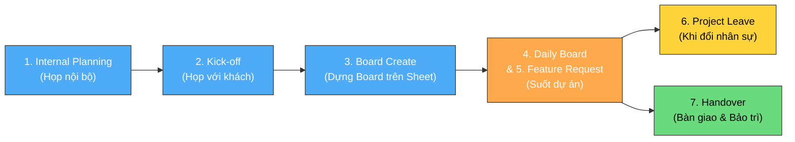

# 🎯 Cẩm Nang Toàn Tập Dành Cho Product Owner (PO Handbook)

Tại Cyberk, **Product Owner (PO)** là người cầm lái dự án từ ngày đầu tiên ký hợp đồng cho đến lúc bàn giao sản phẩm lên sóng — là đầu mối duy nhất của khách hàng (*single point of contact*), đồng thời là người giữ nhịp cho toàn bộ đội ngũ Design, Dev và QA.

Cuốn cẩm nang này được sắp xếp theo **đúng trình tự thời gian của một dự án thực tế**. Nếu bạn là PO mới tại Cyberk, hãy đọc tuần tự từ **Chương 1 đến Chương 7**: mỗi chương đều đi từ **Cẩm nang tư duy (`Handbook`)** → **Quy trình & Checklist (`Process`)** → **Mẫu thực tế (`Example`)**.

---

## 🗺️ Hành trình PO theo vòng đời dự án

---

## 📖 Mục Lục Thứ Tự Đọc (Từ Đầu Tới Cuối)

### Phần I — Khởi động dự án *(Sau khi ký hợp đồng → Trước Sprint 1)*

#### Chương 1: Họp Lập Kế Hoạch Nội Bộ ([`po-planning/`](./po-planning/))
> *Cả team ngồi lại hiểu mục tiêu kinh doanh của khách và thống nhất chiến lược triển khai trước khi viết dòng code đầu tiên.*

| Thứ tự | Bài đọc | Loại | Nội dung cốt lõi |
|:------:|---------|------|------------------|
| **1.1** | [Planning — Cẩm nang cho PO](./po-planning/planning-handbook.md) | Handbook | Tại sao buổi planning quyết định thành bại dự án & cách dẫn dắt cuộc họp |
| **1.2** | [Quy trình Internal Planning](./po-planning/planning-process.md) | Process | Các bước chuẩn bị, họp nội bộ, xuất Planning Report gửi khách ngay trong ngày |

#### Chương 2: Kick-off Dự Án với Khách Hàng ([`po-kick-off/`](./po-kick-off/))
> *Ấn tượng đầu tiên quyết định niềm tin của khách hàng trong suốt dự án — thiết lập kỳ vọng, nhịp làm việc 24h và cách xử lý thay đổi.*

| Thứ tự | Bài đọc | Loại | Nội dung cốt lõi |
|:------:|---------|------|------------------|
| **2.1** | [Kick-off với Khách hàng — Cẩm nang](./po-kick-off/kick-off-handbook.md) | Handbook | Cách kiểm soát kỳ vọng, gửi summary trước file và dẫn dắt buổi call |
| **2.2** | [Quy trình Kick-off Meeting](./po-kick-off/kick-off-process.md) | Process | Luồng 4 bước từ tin nhắn sáng ngày đầu đến email tổng kết sau call |
| **2.3** | [Mẫu Agenda, Tin nhắn & Email Kick-off](./po-kick-off/kick-off-example.md) | Example | Trọn bộ tin nhắn chào hỏi, summary Planning Report, agenda & email recap |

#### Chương 3: Khởi Tạo Board Dự Án ([`po-board-create/`](./po-board-create/))
> *Chưa có Board chuẩn thì chưa bắt đầu dự án — nơi mọi tiến độ tự hiển thị trong 10 giây không cần hỏi.*

| Thứ tự | Bài đọc | Loại | Nội dung cốt lõi |
|:------:|---------|------|------------------|
| **3.1** | [Khởi tạo Board — Cẩm nang cho PO](./po-board-create/board-create-handbook.md) | Handbook | 8 cột bắt buộc, các tab chuẩn, cách estimate cùng Dev |
| **3.2** | [Quy trình Khởi tạo Board](./po-board-create/board-create-process.md) | Process | Luồng 4 bước `TEMPLATE → ESTIMATE → ASSIGN → PLAN` & Board Rule |

---

### Phần II — Vận hành hàng ngày & Xử lý biến động *(Suốt dự án)*

#### Chương 4: Quản Lý Board Hàng Ngày ([`board-handbook/`](./board-handbook/))
> *Cách giữ cho nhịp đập dự án luôn minh bạch, phát hiện điểm nghẽn trước khi trễ hạn.*

| Thứ tự | Bài đọc | Loại | Nội dung cốt lõi |
|:------:|---------|------|------------------|
| **4.1** | [Cẩm nang Quản lý Board](./board-handbook/board-handbook.md) | Handbook | Cách đọc board mỗi ngày, dấu hiệu board tốt vs board chết, tiêu chuẩn tạo task |

#### Chương 5: Tiếp Nhận & Xử Lý Yêu Cầu Tính Năng Mới ([`po-feature-request/`](./po-feature-request/))
> *Biến nhu cầu mở rộng sản phẩm của khách thành cơ hội tăng doanh thu mà vẫn bảo vệ tuyệt đối ngày Launch.*

| Thứ tự | Bài đọc | Loại | Nội dung cốt lõi |
|:------:|---------|------|------------------|
| **5.1** | [Xử lý Feature Request — Cẩm nang cho PO](./po-feature-request/feature-request-handbook.md) | Handbook | Tư duy cơ hội, gỡ 3 nỗi sợ thấy "phiền", mẹo làm tròn giảm 10%–15% & xử lý lệch ý giao tiếp |
| **5.2** | [Quy trình Tiếp nhận & Xử lý Feature Request](./po-feature-request/feature-request-process.md) | Process | Luồng 4 bước `UNDERSTAND → ESTIMATE (≤ 24h) → APPROVAL → PROPOSAL ($25/h)` & Email confirm |
| **5.3** | [Mẫu Tin nhắn Không Tốt vs Tốt](./po-feature-request/feature-request-example.md) | Example | Chuỗi tình huống thực chiến với khách hàng Jon từ sau buổi họp đến Email chốt confirm |

#### Chương 6: Điều Phối Khi Thành Viên Rời Dự Án ([`po-project-leave/`](./po-project-leave/))
> *Đảm bảo không đứt gãy tiến độ, không thất thoát tri thức và an toàn bảo mật khi có biến động nhân sự.*

| Thứ tự | Bài đọc | Loại | Nội dung cốt lõi |
|:------:|---------|------|------------------|
| **6.1** | [Cẩm nang Rời Dự Án dành cho PO](./po-project-leave/po-project-leave-lead-handbook.md) | Handbook | Trách nhiệm của PO khi điều phối bàn giao công việc và thu hồi quyền truy cập |
| **6.2** | [Quy trình Chuyển giao & Rời Dự Án](./po-project-leave/po-project-leave-process.md) | Process | Các mốc bàn giao mã nguồn, tài liệu, tài khoản và checklist kiểm tra an toàn |

---

### Phần III — Đóng gói & Bàn giao sản phẩm *(Kết thúc hợp đồng)*

#### Chương 7: Bàn Giao Sản Phẩm Cho Khách Hàng ([`po-handover/`](./po-handover/))
> *Khoảnh khắc quyết định ấn tượng cuối cùng — khép lại giai đoạn build êm đẹp để mở ra gói bảo trì hoặc hợp đồng tiếp theo.*

| Thứ tự | Bài đọc | Loại | Nội dung cốt lõi |
|:------:|---------|------|------------------|
| **7.1** | [Bàn giao sản phẩm — Cẩm nang cho PO](./po-handover/handover-handbook.md) | Handbook | Kiểm soát narrative buổi bàn giao và đặt kỳ vọng đúng cho giai đoạn bảo trì |
| **7.2** | [Quy trình Bàn giao sản phẩm](./po-handover/handover-process.md) | Process | Chuẩn bị repo & tài liệu, hẹn lịch, dẫn dắt buổi call bàn giao và gửi email tổng kết |
| **7.3** | [Mẫu Tin nhắn & Email Bàn giao](./po-handover/handover-example.md) | Example | Các mẫu thông báo hoàn thành development, agenda bàn giao & email xác nhận |
| **7.4** | [Chính sách & SLA Bảo trì](./po-handover/maintenance-policy-reference.md) | Reference | Bảng tra cứu phạm vi bảo trì miễn phí 30 ngày và SLA xử lý sự cố sau bàn giao |

---

## 🧰 Tài liệu công cụ & Biểu mẫu đi kèm *(Dùng trên máy tính, không in vào sách)*

Các tài liệu dưới đây là file gửi riêng cho khách hàng, biểu mẫu để copy điền chữ hoặc tập lệnh dành cho AI thực thi:

- **Tài liệu gửi khách trước Kick-off:** [cyberk-zero-to-product-en.pdf](./before-kick-off-docs/cyberk-zero-to-product-en.pdf) *(xem hướng dẫn tại [before-kick-off-docs/README.md](./before-kick-off-docs/README.md))*
- **Biểu mẫu BRD & Báo giá mở rộng (Feature Request):** [feature-request-brd-template.md](./po-feature-request/template/feature-request-brd-template.md)
- **Biểu mẫu & AI Instruction cho Internal Planning:** [planning-template.md](./po-planning/planning-ai-instruction/planning-template.md) · [planning-instruction.md](./po-planning/planning-ai-instruction/planning-instruction.md)
- **AI Instruction soạn nháp task cho Board:** [board-create-instruction.md](./po-board-create/board-create-ai-instruction/board-create-instruction.md)
- **Cẩm nang bàn giao dành riêng cho Member rời dự án:** [po-project-leave-member-handbook.md](./po-project-leave/po-project-leave-member-handbook.md)
