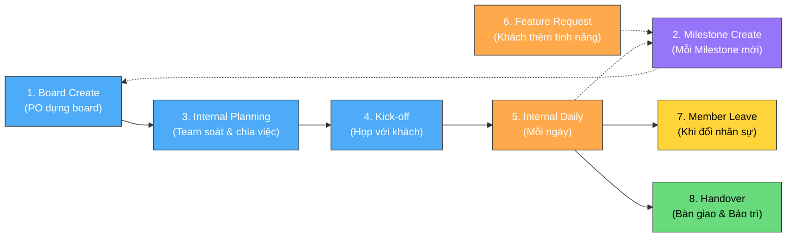

# 🎯 Cẩm Nang Toàn Tập Dành Cho Product Owner (PO Handbook)

Tại Cyberk, **Product Owner (PO)** là người cầm lái dự án từ ngày đầu tiên ký hợp đồng cho đến lúc bàn giao sản phẩm lên sóng — là đầu mối duy nhất của khách hàng (*single point of contact*), đồng thời là người giữ nhịp cho toàn bộ đội ngũ Design, Dev và QA.

Cuốn cẩm nang này được sắp xếp theo **đúng trình tự thời gian của một dự án thực tế**. Nếu bạn là PO mới tại Cyberk, hãy đọc tuần tự từ **Chương 1 đến Chương 8**: mỗi chương đều đi từ **Cẩm nang tư duy (`Handbook`)** → **Quy trình & Checklist (`Process`)** → **Mẫu thực tế (`Example`)**.

---

## 🗺️ Hành trình PO theo vòng đời dự án

> **Chương 2 — Tạo Milestone** được dùng lại ở nhiều chỗ: khi dựng board (Chương 1), khi khách thêm tính năng (Chương 6), và khi buổi Internal Daily phát hiện một đợt việc lớn (Chương 5).

---

## 📖 Mục Lục Thứ Tự Đọc (Từ Đầu Tới Cuối)

### Phần I — Khởi động dự án *(Sau khi ký hợp đồng → Trước Sprint 1)*

> Thứ tự: PO dựng board (Chương 1, dùng Chương 2 cho từng Milestone) → cả team họp Planning (Chương 3) → Kick-off với khách (Chương 4).

#### Chương 1: Khởi Tạo Board Dự Án ([`po-board-create/`](./po-board-create/))
> *Chưa có Board chuẩn thì chưa bắt đầu dự án — nơi mọi tiến độ tự hiển thị trong 10 giây không cần hỏi.*

| Thứ tự | Bài đọc | Loại | Nội dung cốt lõi |
|:------:|---------|------|------------------|
| **1.1** | [Khởi tạo Board — Cẩm nang cho PO](./po-board-create/board-create-handbook.md) | Handbook | Quản lý dự án là gì, 8 cột bắt buộc, các tab chuẩn, Bugs |
| **1.2** | [Quy trình Khởi tạo Board](./po-board-create/board-create-process.md) | Process | Luồng `TEMPLATE → ESTIMATE → PLAN` & Board Rule — PO làm trước buổi Planning |

#### Chương 2: Tạo Milestone Mới ([`po-milestone-create/`](./po-milestone-create/))
> *Từ yêu cầu của khách ra tên Milestone, danh sách task và số giờ — làm được cả khi team chưa được thành lập.*

| Thứ tự | Bài đọc | Loại | Nội dung cốt lõi |
|:------:|---------|------|------------------|
| **2.1** | [Tạo Milestone — Cẩm nang cho PO](./po-milestone-create/milestone-create-handbook.md) | Handbook | Độ lớn & cách đặt tên Milestone, tách task (UX/UI, QA, Refactor, xử lý lỗi), task research, estimate cùng Tech Lead |
| **2.2** | [Quy trình Tạo Milestone](./po-milestone-create/milestone-create-process.md) | Process | Luồng `DEFINE → BREAKDOWN → ESTIMATE` |
| **2.3** | [Mẫu Milestone & Task](./po-milestone-create/milestone-create-example.md) | Example | Tên Milestone, danh sách task của một Milestone, Task, task research — bản chưa tốt và bản tốt |

#### Chương 3: Họp Lập Kế Hoạch Nội Bộ ([`po-planning/`](./po-planning/))
> *Team bước vào buổi họp với board đã sẵn sàng: chốt Key Success Features, chia việc, mỗi người soát việc của mình và cam kết — rồi gửi board cho khách.*

| Thứ tự | Bài đọc | Loại | Nội dung cốt lõi |
|:------:|---------|------|------------------|
| **3.1** | [Planning — Cẩm nang cho PO](./po-planning/planning-handbook.md) | Handbook | Tại sao buổi planning quyết định thành bại dự án, cách dẫn team soát kế hoạch & chia việc |
| **3.2** | [Quy trình Internal Planning](./po-planning/planning-process.md) | Process | Luồng `PRIORITY → ASSIGN → SEND`: chốt Key Success Features, chia việc theo độ quan trọng, cam kết EOD, gửi board cho khách |
| **3.3** | [Mẫu tin nhắn gửi board](./po-planning/planning-example.md) | Example | Tin nhắn summary (Approach, Key Risks, Strategy) gửi kèm board sau buổi Planning |

#### Chương 4: Kick-off Dự Án với Khách Hàng ([`po-kick-off/`](./po-kick-off/))
> *Ấn tượng đầu tiên quyết định niềm tin của khách hàng trong suốt dự án — thiết lập kỳ vọng, nhịp làm việc 24h và cách xử lý thay đổi.*

| Thứ tự | Bài đọc | Loại | Nội dung cốt lõi |
|:------:|---------|------|------------------|
| **4.1** | [Kick-off với Khách hàng — Cẩm nang](./po-kick-off/kick-off-handbook.md) | Handbook | Cách kiểm soát kỳ vọng, gửi summary trước file và dẫn dắt buổi call |
| **4.2** | [Quy trình Kick-off Meeting](./po-kick-off/kick-off-process.md) | Process | Luồng 4 bước từ tin nhắn sáng ngày đầu đến email tổng kết sau call |
| **4.3** | [Mẫu Agenda, Tin nhắn & Email Kick-off](./po-kick-off/kick-off-example.md) | Example | Trọn bộ tin nhắn chào hỏi, gửi tài liệu quy trình, agenda & email recap |

---

### Phần II — Vận hành hàng ngày & Xử lý biến động *(Suốt dự án)*

#### Chương 5: Họp Internal Daily & Báo cáo Khách hàng ([`po-internal-daily/`](./po-internal-daily/))
> *Mỗi ngày: cả team xem sản phẩm, sửa board cho đúng thực tế, gửi khách bản PDF export từ board.*

| Thứ tự | Bài đọc | Loại | Nội dung cốt lõi |
|:------:|---------|------|------------------|
| **5.1** | [Internal Daily — Cẩm nang cho PO](./po-internal-daily/internal-daily-handbook.md) | Handbook | Demo cả trường hợp lỗi, sửa board sau Demo, 17 dấu hiệu quản lý dự án không tốt, Daily Report |
| **5.2** | [Quy trình Internal Daily](./po-internal-daily/internal-daily-process.md) | Process | Luồng `DEMO → CHANGE → REPORT` |
| **5.3** | [Mẫu Daily Report & Tin nhắn Summary](./po-internal-daily/internal-daily-example.md) | Example | Daily Report 4 câu hỏi, tin nhắn summary kèm PDF — bản chưa tốt và bản tốt |

#### Chương 6: Tiếp Nhận & Xử Lý Yêu Cầu Tính Năng Mới ([`po-feature-request/`](./po-feature-request/))
> *Biến nhu cầu mở rộng sản phẩm của khách thành cơ hội tăng doanh thu mà vẫn bảo vệ tuyệt đối ngày Launch.*

| Thứ tự | Bài đọc | Loại | Nội dung cốt lõi |
|:------:|---------|------|------------------|
| **6.1** | [Xử lý Feature Request — Cẩm nang cho PO](./po-feature-request/feature-request-handbook.md) | Handbook | Tư duy cơ hội, gỡ 3 nỗi sợ thấy "phiền", mẹo làm tròn giảm 10%–15% & xử lý lệch ý giao tiếp |
| **6.2** | [Quy trình Tiếp nhận & Xử lý Feature Request](./po-feature-request/feature-request-process.md) | Process | Luồng 4 bước `UNDERSTAND → ESTIMATE (≤ 24h) → APPROVAL → PROPOSAL ($25/h)` & Email confirm |
| **6.3** | [Mẫu Tin nhắn Không Tốt vs Tốt](./po-feature-request/feature-request-example.md) | Example | Chuỗi tình huống thực chiến với khách hàng Jon từ sau buổi họp đến Email chốt confirm |

#### Chương 7: Điều Phối Khi Thành Viên Rời Dự Án ([`po-member-leave/`](./po-member-leave/))
> *Đảm bảo không đứt gãy tiến độ, không thất thoát tri thức và an toàn bảo mật khi có biến động nhân sự.*

| Thứ tự | Bài đọc | Loại | Nội dung cốt lõi |
|:------:|---------|------|------------------|
| **7.1** | [Cẩm nang Rời Dự Án dành cho PO](./po-member-leave/member-leave-lead-handbook.md) | Handbook | Trách nhiệm của PO khi điều phối bàn giao công việc và thu hồi quyền truy cập |
| **7.2** | [Quy trình Rời Dự Án](./po-member-leave/member-leave-process.md) | Process | 4 bước `THANK-YOU → HANDOVER → REMOVE → AGREEMENT`, file kinh nghiệm bảo trì và cam kết hoàn tất |

---

### Phần III — Đóng gói & Bàn giao sản phẩm *(Kết thúc hợp đồng)*

#### Chương 8: Bàn Giao Sản Phẩm Cho Khách Hàng ([`po-handover/`](./po-handover/))
> *Khoảnh khắc quyết định ấn tượng cuối cùng — khép lại giai đoạn build êm đẹp để mở ra gói bảo trì hoặc hợp đồng tiếp theo.*

| Thứ tự | Bài đọc | Loại | Nội dung cốt lõi |
|:------:|---------|------|------------------|
| **8.1** | [Bàn giao sản phẩm — Cẩm nang cho PO](./po-handover/handover-handbook.md) | Handbook | Kiểm soát narrative buổi bàn giao và đặt kỳ vọng đúng cho giai đoạn bảo trì |
| **8.2** | [Quy trình Bàn giao sản phẩm](./po-handover/handover-process.md) | Process | Chuẩn bị repo & tài liệu, hẹn lịch, dẫn dắt buổi call bàn giao và gửi email tổng kết |
| **8.3** | [Mẫu Tin nhắn & Email Bàn giao](./po-handover/handover-example.md) | Example | Các mẫu thông báo hoàn thành development, agenda bàn giao & email xác nhận |
| **8.4** | [Chính sách & SLA Bảo trì](./po-handover/maintenance-policy-reference.md) | Reference | Bảng tra cứu phạm vi bảo trì miễn phí 30 ngày và SLA xử lý sự cố sau bàn giao |

---

## 🧰 Tài liệu công cụ & Biểu mẫu đi kèm *(Dùng trên máy tính, không in vào sách)*

Các tài liệu dưới đây là file gửi riêng cho khách hàng, biểu mẫu để copy điền chữ hoặc tập lệnh dành cho AI thực thi:

- **Biểu mẫu BRD & Báo giá mở rộng (Feature Request):** [feature-request-brd-template.md](./po-feature-request/template/feature-request-brd-template.md)
- **Cẩm nang bàn giao dành riêng cho Member rời dự án:** [member-leave-member-handbook.md](./po-member-leave/member-leave-member-handbook.md)
