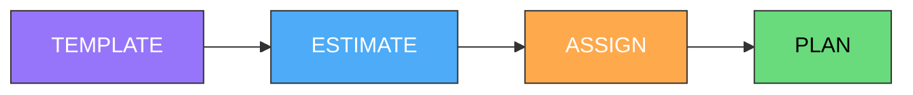

# Khởi tạo Board dự án trên Google Sheet

**Người chịu trách nhiệm:** PO dự án
**Cập nhật lần cuối:** 2026-11-26
**Trạng thái:** Nháp

## Tại sao có trang này

Board là bản mô phỏng trạng thái thực tế của dự án. Sếp không ngồi cạnh dev cả ngày — nhưng mở board ra, **dưới 10 giây phải biết:** tuần này team đang ở đâu, có ai bị kẹt không, có task nào trễ hạn không. Nếu phải hỏi thêm mới hiểu — board đã thất bại.

Một board dựng vội — task không có số giờ, không có người nhận, không có ngày xong — sẽ đẩy dự án vào một trong hai bẫy: **sprint bị nhồi quá sức** mà tới thứ Sáu mới biết trễ, hoặc **việc rơi vào khoảng trống** vì ai cũng *"tưởng anh kia đang làm"*. Và khách hàng — người nhận bản PDF export từ board mỗi ngày — sẽ là người đầu tiên nhìn thấy sự lộn xộn đó.

Quy trình này đảm bảo mọi board đều đi qua cùng một chuẩn trước khi Sprint 1 bắt đầu: **mỗi task có số giờ, có đúng một người chịu trách nhiệm, và có ngày hoàn thành cụ thể.**

## Khi nào áp dụng (Trigger)

Áp dụng ngay sau khi [Internal Planning](../po-planning/planning-process.md) hoàn tất — **trước khi giao task đầu tiên**:
- Dự án mới vừa ký hợp đồng.
- Tiếp nhận một dự án đang chạy nhưng chưa có board chuẩn.
- Bộ phận / phòng ban cần board quản lý riêng.

---

## Luồng chính

---

## Vai trò & trách nhiệm

| Vai trò | Chịu trách nhiệm gì |
|---------|---------------------|
| **Product Owner (PO)** | Copy `TEMPLATE` và dọn dữ liệu mẫu (*Template*); ngồi cùng Dev tách task và ghi số giờ (*Estimate*); chủ trì buổi họp giao việc (*Assign*); chốt ngày hoàn thành, phân quyền và gửi link board cho team & khách (*Plan*) |
| **Tech Lead / Dev** | Ước lượng số giờ, chỉ ra hạng mục kỹ thuật còn thiếu, tách nhỏ task quá 4 tiếng (*Estimate*); cùng PO kiểm thứ tự phụ thuộc giữa các task (*Plan*) |
| **Team members** | Nhận task và xác nhận vừa sức ngay trong buổi họp (*Assign*); xác nhận ngày hoàn thành của task mình (*Plan*); từ đó trở đi tự cập nhật tiến độ mỗi ngày |
| **Khách hàng** | Có quyền **xem** board. Mọi yêu cầu mới gửi qua Telegram cho PO — không sửa trực tiếp trên board |

---

## Các bước

| # | Việc làm | Ai làm | Đầu ra | Timeline |
|---|----------|--------|--------|----------|
| 1 | **TEMPLATE — Copy template chuẩn của Cyberk:** Mở [`TEMPLATE`](https://docs.google.com/spreadsheets/d/1PA2c5UgSfVdYbqnafB0_hLelpRm8gluAt0MIA2W8vlg) → *Tệp → Tạo bản sao* → đặt tên `[Project]-Management` → lưu vào folder [Project Management](https://drive.google.com/drive/folders/1Yo-AivRaa4vDYkOE9-UEP5W3nNjzlj5S). Xoá task mẫu và tên dự án cũ ở các tab sprint và tab `Members` | PO | **Board mới** đúng chuẩn, đã sạch dữ liệu mẫu | Ngay sau Internal Planning |
| 2 | **ESTIMATE — Ước lượng số giờ cho từng hạng mục:** PO ngồi cùng Tech Lead / Dev đi qua từng Milestone trong Planning Report, tách thành task và ghi số giờ vào cột **Estimate (h)**, kiểm theo Board Rule ở phần Quy tắc cứng bên dưới | PO + Tech Lead / Dev | **Danh sách task** đủ Milestones, Tasks, **Estimate (h)** trên tab `sprint_1` | Sau TEMPLATE |
| 3 | **ASSIGN — Chọn người cho từng task:** PO họp cùng team (Dev, QA, Designer), đi qua danh sách task đã estimate và chọn **đúng một người** cho mỗi task ở cột **Assignee**, đúng vai trò *(task UX/UI cho Designer, task QA cho QA)*. Ai bị dồn quá tải thì chuyển bớt cho người khác hoặc đưa sang `sprint_2`. Member xác nhận task của mình ngay trong buổi họp | PO + Team | **Mỗi task có đúng 1 Assignee**, member đã xác nhận | Sau ESTIMATE, trước ngày đầu Sprint 1 |
| 4 | **PLAN — Ước lượng ngày hoàn thành:** Với từng task, PO cùng người được giao chốt **Expected done date** dựa trên Estimate và thứ tự phụ thuộc: • Task nền tảng xong trước, task phụ thuộc xong sau • Task QA của một Milestone xong sau các task dev của Milestone đó • Việc không kịp trong tuần thì đưa sang `sprint_2` với ngày cụ thể Chốt xong, PO điền **Upcoming Milestones** ở đầu tab sprint, phân quyền *(team: chỉnh sửa, khách hàng: xem)* và gửi link board vào group Telegram dự án | PO + Member | **Board hoàn chỉnh** + **link đã gửi team & khách** | Ngay sau ASSIGN, trước ngày đầu Sprint 1 |

---

## Quy tắc cứng (không được vi phạm) + lý do

| Quy tắc | Lý do |
|---------|-------|
| Mỗi Milestones phải có 1 task UX/UI | Design đi trước code, không để dev code xong mới thiếu màn hình |
| Mỗi Milestones phải có 1 task dành cho QA | Không có dòng trên board thì không ai test |
| Mỗi Milestones phải có 1 task dành cho Code Refactor | Trả nợ kỹ thuật đều đặn, không để dồn |
| Mỗi Sub-task không quá 4 tiếng | Task nhỏ thì estimate đúng hơn và xong được trong ngày |
| Mỗi member có đủ 2 task mỗi ngày, 10 task mỗi tuần | Không ai ngồi chơi, không ai ôm quá sức |
| Tên các Task và Milestone phải meaningful, khách hàng đọc phải hiểu | Khách nhận board dưới dạng PDF mỗi ngày |
| Meeting minutes với khách hàng có tasks mới phải cập nhật vào board ngay | Việc không lên board thì không tồn tại |
| PO có trách nhiệm đưa task lên board, và Assign cho member | Một người chịu trách nhiệm, không đùn đẩy |
| Member có trách nhiệm cập nhật tiến độ | Người làm là người biết rõ nhất |
| Luôn copy từ `TEMPLATE`, lưu trong folder Project Management | Mọi board cùng một chuẩn, cả team + COO cùng thấy |
| Tên tab đặt theo sprint: `sprint_1`, `sprint_2`... | Mọi task luôn thuộc một sprint, có người, có ngày |

---

## Ngoại lệ & Escalation

| Tình huống | Hành động |
|-----------|----------|
| Dev đang chạy dự án khác, **chưa ngồi estimate kịp** | PO estimate nháp trước *(có thể nhờ AI soạn từ Planning Report)*, ghi `Chờ Dev xác nhận` ở cột Notes. Dev xác nhận lại ngay trong buổi Assign. **Mọi task luôn có số Estimate** |
| Task **không tách được dưới 4 tiếng** *(research, tích hợp bên thứ ba chưa rõ tài liệu)* | Tạo trước một task research ≤ 4 tiếng để tìm hiểu. Có kết quả research rồi mới estimate phần làm thật |
| Member **chưa đủ 2 task mỗi ngày** | Kéo thêm việc từ sprint sau lên. Nếu dự án thật sự hết việc → báo Anderson để điều phối member sang hỗ trợ dự án khác |
| Tổng Estimate **vượt sức team** nhưng ngày Launch không đổi được | Giữ nhịp làm việc bình thường của team. Escalate lên **AM (Anderson / Brian)** để đàm phán với khách dời bớt scope sang phase sau |
| Khách **thêm việc mới** ngay lúc đang dựng board | Dưới 8 giờ → đưa thẳng lên board. Từ 8 giờ trở lên → đi theo [quy trình Feature Request](../po-feature-request/feature-request-process.md) |
| Không có quyền copy `TEMPLATE` hoặc lưu vào folder Project Management | Liên hệ Anderson |

---

## Checklist mỗi board mới

- [ ] **Template:** Board copy từ `TEMPLATE`, tên đúng `[Project]-Management`, nằm trong folder Project Management, đã xoá hết task mẫu và tên dự án cũ *(kể cả tab `Members`)*
- [ ] **Estimate:** Đã ngồi cùng Dev, mọi task có **Estimate (h)**, tên Task và Milestone khách đọc là hiểu, không task nào quá 4 tiếng, mỗi Milestone đủ task UX/UI, QA, Code Refactor
- [ ] **Assign:** Mỗi task có đúng 1 Assignee, mỗi member đủ 2 task/ngày – 10 task/tuần, member đã xác nhận trong buổi họp
- [ ] **Plan:** Mọi task có **Expected done date** trong tuần, việc không kịp đã có ngày cụ thể trong `sprint_2`, đã điền Upcoming Milestones, team có quyền chỉnh sửa – khách có quyền xem, link đã gửi vào group Telegram

---

## Liên kết

- [Cẩm nang Board — Triết lý & cách nghĩ](./board-create-handbook.md) — Vì sao dùng Sheet, 8 cột, các tab, mẹo khi Estimate / Assign / Plan, mẫu tốt/tồi
- [AI Instruction — Soạn nháp task từ Planning Report](./board-create-ai-instruction/board-create-instruction.md) — Để buổi Estimate cùng Dev nhanh hơn
- [Quản lý Board hằng ngày](../board-handbook/board-handbook.md) — Bước tiếp theo: cập nhật tiến độ, Daily Report và export PDF gửi khách
- [Internal Planning — Họp nội bộ](../po-planning/planning-process.md) — Bước trước
- [Feature Request](../po-feature-request/feature-request-process.md) — Khi khách thêm việc từ 8 giờ trở lên
