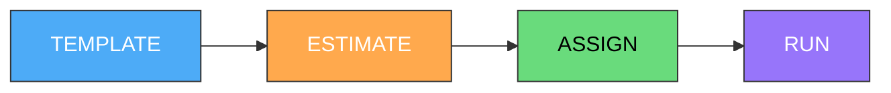

# Khởi tạo Board dự án trên Google Sheet

**Người chịu trách nhiệm:** [PO / Tech Lead]
**Cập nhật lần cuối:** 2026-11-25
**Trạng thái:** Nháp

## Tại sao có trang này

Board là bản mô phỏng trạng thái thực tế của dự án. Sếp không ngồi cạnh dev cả ngày — nhưng mở board ra, **dưới 10 giây phải biết:** tuần này team đang ở đâu, có ai bị kẹt không, có task nào trễ hạn không. Nếu phải hỏi thêm mới hiểu — board đã thất bại.

Board tệ — thiếu cột, thiếu Estimate — khiến bức tranh bị mờ. Trang này đảm bảo mọi board đều sẵn sàng từ ngày đầu.

## Khi nào áp dụng (Trigger)

- Ngay sau khi [Internal Planning](../po-planning/planning-process.md) hoàn tất — **trước khi tạo task đầu tiên**.
- Khi có dự án mới được ký hợp đồng.
- Khi bộ phận / phòng ban cần board quản lý riêng.

---

## Luồng chính

- **TEMPLATE** — Copy template chuẩn của Cyberk, để board không bị lỗi thời và chuẩn nhất.
- **ESTIMATE** — PO estimate thời gian cùng Dev, để không bị thiếu hạng mục.
- **ASSIGN** — Họp cùng team, phân chia công việc cho từng member.
- **RUN** — Hằng ngày export tiến độ ra PDF, kèm Daily Report ở đầu trang, gửi cho khách hàng.

---

## Vai trò & trách nhiệm

| Vai trò | Chịu trách nhiệm gì |
|---------|---------------------|
| **PO / Tech Lead** | Copy TEMPLATE. Estimate cùng Dev. Đưa task lên board và assign cho member. Export PDF + Daily Report gửi khách mỗi ngày |
| **Dev** | Estimate cùng PO — chỉ ra hạng mục còn thiếu, task nào quá 4 tiếng cần tách nhỏ |
| **Team members** | Nhận task trong buổi họp ASSIGN. Cập nhật tiến độ trên board mỗi ngày |

---

## Các bước

| # | Bước | Việc làm | Ai làm | Đầu ra |
|---|------|----------|--------|--------|
| 1 | **TEMPLATE** | Mở [`TEMPLATE`](https://docs.google.com/spreadsheets/d/1PA2c5UgSfVdYbqnafB0_hLelpRm8gluAt0MIA2W8vlg) → *Tệp → Tạo bản sao* → đặt tên `[Project]-Management` → lưu vào folder [Project Management](https://drive.google.com/drive/folders/1Yo-AivRaa4vDYkOE9-UEP5W3nNjzlj5S). Xoá task mẫu và tên dự án cũ | PO/TL | Board sạch, đúng chuẩn |
| 2 | **ESTIMATE** | Ngồi cùng Dev, đi qua từng Milestone trong Planning Report: tách task, ghi Estimate (h). Kiểm Board Rule: mỗi Milestone đủ task UX/UI, QA, Code Refactor; không task nào quá 4 tiếng | PO/TL + Dev | Danh sách task đầy đủ, có Estimate |
| 3 | **ASSIGN** | Họp cùng team: phân task cho từng member, mỗi task 1 người. Mỗi member đủ 2 task/ngày, 10 task/tuần. Việc không vừa tuần này → đưa sang `sprint_2` | PO/TL + Team | `sprint_1` đã assign đủ |
| 4 | **RUN** | Phân quyền (team: chỉnh sửa, khách: xem), gửi link board qua Telegram. Từ hôm sau: mỗi ngày viết Daily Report ở đầu tab sprint → export PDF → gửi khách | PO/TL | Khách nhận PDF mỗi ngày |

> 📖 **AI hỗ trợ soạn nháp task từ Planning Report:** xem [Board Create — AI Instruction](./board-create-ai-instruction/board-create-instruction.md)

---

## Board cần có gì?

### 8 cột bắt buộc

| Cột | Ghi chú |
|-----|---------|
| Milestones | Mốc bàn giao hoặc tên tính năng — task không có Milestone = task trôi nổi |
| Tasks | Khách đọc phải hiểu — vì mỗi ngày board được export PDF gửi khách |
| Assignee | Mỗi task chỉ 1 người |
| Status | 4 giá trị: `Todo`, `Doing`, `Pending`, `Done` |
| Progress | `0%` → `100%` |
| **Estimate (h)** | Giờ công, không quá 4h/task — nhận ra Sprint overload sớm |
| Expected done date | Hạn chót, nằm trong tuần của sprint |
| Notes | Lý do `Pending`, task chuyển sprint... |

### Các tab chuẩn

| Tab | Mục đích |
|-----|---------|
| 📌 **`sprint_1`, `sprint_2`...** | Tuần này team làm gì? Daily Report ở đầu tab, bảng task bên dưới |
| 📊 **`Members`** | Mỗi người đang làm bao nhiêu, tiến độ tuần này so với tuần trước? |
| 📖 **`README`** | Board Rule của dự án |
| 🗂️ **`data`** *(ẩn)* | Tự gom task từ các tab sprint bằng QUERY — không sửa tay |

> **Không có tab Backlog.** Việc chưa xếp được vào sprint hiện tại → đưa sang sprint tiếp theo.

---

## Board Rule

Board Rule nằm ở tab `README` của mọi board. Đây là luật, không phải gợi ý:

- Mỗi Milestones phải có 1 task UX/UI
- Mỗi Milestones phải có 1 task dành cho QA
- Mỗi Milestones phải có 1 task dành cho Code Refactor
- Mỗi Sub-task không quá 4 tiếng
- Mỗi member có đủ 2 task mỗi ngày, 10 task mỗi tuần
- Tasks descriptions phải meaningful với khách hàng, tức là khách hàng đọc phải hiểu
- Meeting minutes với khách hàng có tasks mới phải cập nhật vào board ngay
- PO có trách nhiệm đưa task lên board, và Assign cho member
- Member có trách nhiệm cập nhật tiến độ

---

## Quy tắc cứng + lý do

| Quy tắc | Lý do |
|---------|-------|
| **Tên board đúng convention** (`[Project]-Management` / tên bộ phận) | Tên lung tung → 6 tháng sau không ai biết board nào của dự án nào |
| **Đủ 8 cột, Estimate không bỏ trống** | Thiếu cột = board không trả lời được 1 câu hỏi. Thiếu Estimate = không biết sprint có bị nhồi quá không |
| **Status chỉ 4 giá trị** | Thêm "Review"/"Blocked" → mỗi người hiểu khác nhau, task kẹt giữa cột |
| **Không có tab Backlog** | Backlog là nơi task đến rồi nằm chết. Đưa sang sprint sau → task luôn có ngày, có người |
| **PO estimate cùng Dev, không estimate một mình** | PO một mình sẽ sót hạng mục kỹ thuật. Dev một mình sẽ sót hạng mục khách cần |
| **Mỗi task đúng 1 Assignee** | 2 người assign = không ai chịu trách nhiệm |
| **Mỗi ngày gửi khách PDF export từ board, kèm Daily Report ở đầu trang** | Khách thấy đúng tiến độ thật, không có "bản báo cáo" lệch với board |
| **Board tạo TRƯỚC task đầu tiên** | Task trước board → thiếu cột, thiếu Estimate, sửa sau mất gấp 3 |
| **Copy từ `TEMPLATE`, lưu trong folder Project Management, không Drive cá nhân** | Board cá nhân = chỉ mình thấy. Board trong folder chung = cả team + COO |

---

## Checklist

### TEMPLATE
- [ ] Đã copy từ `TEMPLATE`, nằm trong folder Project Management
- [ ] Tên đúng convention `[Project]-Management`
- [ ] Đã xoá hết task mẫu và tên dự án cũ (kể cả tab `Members`)

### ESTIMATE
- [ ] Đã estimate cùng Dev, mọi task có Estimate (h)
- [ ] Không task nào quá 4 tiếng
- [ ] Mỗi Milestone có task UX/UI, QA, Code Refactor

### ASSIGN
- [ ] Đã họp cùng team, mỗi task đúng 1 Assignee
- [ ] Mỗi member đủ 2 task/ngày, 10 task/tuần
- [ ] Mỗi member confirm task của mình

### RUN
- [ ] Team: quyền chỉnh sửa. Khách: quyền xem
- [ ] Link board đã gửi qua Telegram
- [ ] Đã thử export PDF tab `sprint_1` — kèm Daily Report ở đầu trang, đọc rõ, không bị cắt cột

---

## Ngoại lệ & Escalation

| Tình huống | Hành động |
|-----------|----------|
| Không có quyền copy TEMPLATE hoặc lưu vào folder Project Management | Liên hệ Anderson |
| Dự án nhỏ, 1–2 người | Vẫn dùng đủ TEMPLATE. Board Rule vẫn áp dụng |
| Board bộ phận (design, qa...) | Giữ 8 cột. Milestones thay bằng loại công việc |
| Kế thừa board cũ (GitHub Projects hoặc Sheet cũ) | Tạo board mới từ TEMPLATE, chuyển task chưa xong vào sprint hiện tại |
| Tab `Members` báo `#ERROR!` | Kiểm tra công thức QUERY ở tab `data` đã có đủ các tab sprint chưa |

---

## Liên kết

- [AI Instruction — Soạn task từ Planning Report](./board-create-ai-instruction/board-create-instruction.md)
- [Cẩm nang Board — Triết lý & cách nghĩ](./board-create-handbook.md)
- [Board Handbook — Tổng quan quản lý dự án](../board-handbook/board-handbook.md)
- [Dev Tasks Logs — Tạo task (bước sau khi có board)](../dev-tasks-logs/dev-tasks-logs-process.md)
- [Internal Planning — Họp nội bộ (bước trước)](../po-planning/planning-process.md)
