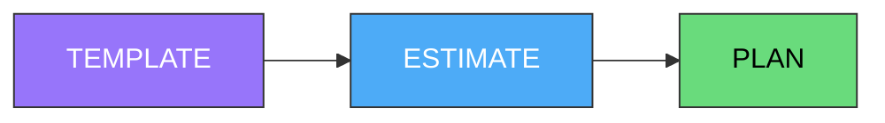

# Khởi tạo Board dự án trên Google Sheet

**Người chịu trách nhiệm:** PO dự án
**Cập nhật lần cuối:** 2026-11-26
**Trạng thái:** Nháp

## Tại sao có trang này

Board là bản mô phỏng trạng thái thực tế của dự án. Sếp không ngồi cạnh dev cả ngày — nhưng mở board ra, **dưới 10 giây phải biết:** tuần này team đang ở đâu, có ai bị kẹt không, có task nào trễ hạn không. Nếu phải hỏi thêm mới hiểu — board đã thất bại.

Một board dựng vội — task không có số giờ, không có người nhận, không có ngày xong — sẽ đẩy dự án vào một trong hai bẫy: **sprint bị nhồi quá sức** mà tới thứ Sáu mới biết trễ, hoặc **việc rơi vào khoảng trống** vì ai cũng *"tưởng anh kia đang làm"*. Khách nhận bản PDF export từ board mỗi ngày, nên board lộn xộn thì khách cũng thấy.

Quy trình này là việc PO làm **trước buổi Internal Planning**, để team bước vào buổi họp với mọi thứ đã sẵn sàng: **đủ Milestone, đủ task, mỗi task có số giờ và ngày hoàn thành dự kiến.** Trong buổi Planning, team chỉ còn soát lại kế hoạch và chia việc.

## Khi nào áp dụng (Trigger)

Áp dụng ngay sau khi dự án được ký hợp đồng — **trước buổi [Internal Planning](../po-planning/planning-process.md)**:
- Dự án mới vừa ký hợp đồng.
- Tiếp nhận một dự án đang chạy nhưng chưa có board chuẩn.
- Bộ phận / phòng ban cần board quản lý riêng.

---

## Luồng chính

---

## Vai trò & trách nhiệm

| Vai trò | Chịu trách nhiệm gì |
|---------|---------------------|
| **Product Owner (PO)** | Copy `TEMPLATE` và dọn dữ liệu mẫu (*Template*); tạo Milestone và task, ghi số giờ cùng Tech Lead (*Estimate*); xếp task vào các sprint, ghi ngày hoàn thành dự kiến, gửi link board cho team trước buổi Planning (*Plan*) |
| **Tech Lead / Dev có kinh nghiệm** | Ước lượng số giờ, chỉ ra hạng mục kỹ thuật còn thiếu, tách nhỏ task quá 4 tiếng (*Estimate*); cùng PO kiểm thứ tự phụ thuộc giữa các task (*Plan*) |

---

## Các bước

| # | Việc làm | Ai làm | Đầu ra | Timeline |
|---|----------|--------|--------|----------|
| 1 | **TEMPLATE — Copy template chuẩn của Cyberk:** Mở [`TEMPLATE`](https://docs.google.com/spreadsheets/d/1PA2c5UgSfVdYbqnafB0_hLelpRm8gluAt0MIA2W8vlg) → *Tệp → Tạo bản sao* → đặt tên `[Project]-Management` → lưu vào folder [Project Management](https://drive.google.com/drive/folders/1Yo-AivRaa4vDYkOE9-UEP5W3nNjzlj5S). Xoá task mẫu và tên dự án cũ ở các tab sprint và tab `Members` | PO | **Board mới** đúng chuẩn, đã sạch dữ liệu mẫu | Ngay sau khi ký hợp đồng |
| 2 | **ESTIMATE — Ước lượng số giờ cho từng hạng mục:** Với mỗi Milestone trong PRD hoặc proposal đã ký, chạy [quy trình Tạo Milestone](../po-milestone-create/milestone-create-process.md) *(`DEFINE → BREAKDOWN → ESTIMATE`)*. Milestone nào đã được estimate từ trước thì dán thẳng vào board | PO + Tech Lead | **Danh sách task** đủ Milestones, Tasks, **Estimate (h)** | Sau TEMPLATE |
| 3 | **PLAN — Xếp task vào sprint & ước lượng ngày hoàn thành:** PO xếp Milestone theo thứ tự ưu tiên *(Key Success Features bôi đỏ, nằm trên cùng — xem [4 mức ưu tiên](../po-planning/planning-handbook.md))*, rồi xếp task vào `sprint_1`, `sprint_2`... và ghi **Expected done date** dự kiến dựa trên Estimate và thứ tự phụ thuộc: • Task nền tảng xong trước, task phụ thuộc xong sau • Task QA của một Milestone xong sau các task dev của Milestone đó • Việc không vừa tuần này thì đưa sang sprint sau với ngày cụ thể Cột Assignee để trống — team nhận việc trong buổi Planning. Xong, PO cấp quyền chỉnh sửa cho team và gửi link board vào group Internal để team đọc trước | PO + Tech Lead | **Board sẵn sàng cho buổi Planning** + link đã gửi team | Trước buổi Internal Planning ít nhất 1 ngày |

---

## Quy tắc cứng (không được vi phạm) + lý do

| Quy tắc | Lý do |
|---------|-------|
| Mỗi Milestones phải có 1 task UX/UI | Design đi trước code, không để dev code xong mới thiếu màn hình |
| Mỗi Milestones phải có 1 task dành cho QA | Không có dòng trên board thì không ai test |
| Mỗi Milestones phải có 1 task dành cho Code Refactor | Trả nợ kỹ thuật đều đặn, không để dồn |
| Mỗi Sub-task không quá 4 tiếng | Task nhỏ thì estimate đúng hơn và xong được trong ngày |
| Mỗi member có đủ 2 task mỗi ngày, 10 task mỗi tuần | Không ai ngồi chơi, không ai ôm quá sức |
| Tên các Task và Milestone phải meaningful, khách hàng đọc phải hiểu | Khách nhận board dưới dạng PDF mỗi ngày |
| Meeting minutes với khách hàng có tasks mới phải cập nhật vào board ngay | Việc không lên board thì không tồn tại |
| Sửa bug nào thì có task cho đúng bug đó trong tab sprint, link GitHub Issue ở cột Notes | Bug có giờ, có người nhận, QA biết test lại cái gì |
| PO có trách nhiệm đưa task lên board, và Assign cho member | Một người chịu trách nhiệm, không đùn đẩy |
| Member có trách nhiệm cập nhật tiến độ | Người làm là người biết rõ nhất |
| Luôn copy từ `TEMPLATE`, lưu trong folder Project Management | Mọi board cùng một chuẩn, cả team + COO cùng thấy |
| Tên tab đặt theo sprint: `sprint_1`, `sprint_2`... | Mọi task luôn thuộc một sprint, có người, có ngày |

---

## Ngoại lệ & Escalation

| Tình huống | Hành động |
|-----------|----------|
| Xếp xong sprint mà **không kịp ngày Launch** đã cam kết với khách | Giữ nhịp làm việc bình thường của team. Escalate lên **AM (Anderson / Brian)** để đàm phán với khách dời bớt scope sang phase sau, trước buổi Planning |
| Khách **thêm việc mới** ngay lúc đang dựng board | Dưới 8 giờ → đưa thẳng lên board. Từ 8 giờ trở lên → đi theo [quy trình Feature Request](../po-feature-request/feature-request-process.md) |
| Không có quyền copy `TEMPLATE` hoặc lưu vào folder Project Management | Liên hệ Anderson |

---

## Checklist mỗi board mới

- [ ] **Template:** Board copy từ `TEMPLATE`, tên đúng `[Project]-Management`, nằm trong folder Project Management, đã xoá hết task mẫu và tên dự án cũ *(kể cả tab `Members`)*
- [ ] **Estimate:** Mọi Milestone đã đi qua [Tạo Milestone](../po-milestone-create/milestone-create-process.md), mọi task có **Estimate (h)**, tên Task và Milestone khách đọc là hiểu, mỗi Milestone đạt Board Rule
- [ ] **Plan:** Milestone xếp theo thứ tự ưu tiên, mọi task đã nằm trong một sprint và có **Expected done date**, team có quyền chỉnh sửa, link board đã gửi team trước buổi Planning

---

## Liên kết

- [Cẩm nang Board — Triết lý & cách nghĩ](./board-create-handbook.md) — Vì sao dùng Sheet, 8 cột, các tab, mẹo khi Estimate / Plan, mẫu tốt/tồi
- [Tạo Milestone](../po-milestone-create/milestone-create-handbook.md) — Cách đặt tên, tách task, estimate cùng Dev
- [Internal Planning — Họp nội bộ](../po-planning/planning-process.md) — Bước tiếp theo: team soát kế hoạch và chia việc
- [Internal Daily Meeting](../po-internal-daily/internal-daily-process.md) — Cập nhật board hằng ngày, Daily Report và export PDF gửi khách
- [Feature Request](../po-feature-request/feature-request-process.md) — Khi khách thêm việc từ 8 giờ trở lên
