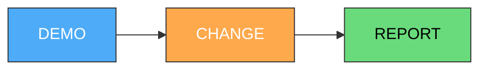

# Họp Internal Daily & Gửi báo cáo cho khách hàng

**Người chịu trách nhiệm:** PO dự án
**Cập nhật lần cuối:** 2026-11-26
**Trạng thái:** Nháp

## Tại sao có trang này

Cyberk sống với triết lý *"Trăm nghe không bằng một thấy"*: chúng ta không nói "sắp xong rồi", chúng ta cho người khác thấy sản phẩm chạy được. Sprint của Cyberk dài 1 tuần, nhưng vòng lặp phản hồi diễn ra **mỗi ngày** — sai hướng thì sửa ngay ngày mai, không phải tuần sau.

Nếu buổi họp hằng ngày chỉ là mỗi người đọc lại việc mình làm, dự án sẽ gặp một trong hai chuyện. Một là **board lệch với thực tế**: task xong vẫn để `Doing`, việc mới phát sinh không ai đưa lên, bản PDF gửi khách sai. Hai là **khách mất niềm tin**: khách không thấy gì mới, tối nào cũng nhắn *"Tiến độ sao rồi em?"*.

Quy trình này giữ cho mỗi ngày đi qua cùng một vòng: team xem sản phẩm, sửa board theo những gì vừa thấy, rồi gửi khách **bản PDF export thẳng từ board**.

## Khi nào áp dụng (Trigger)

Mỗi ngày làm việc của dự án, từ ngày đầu Sprint 1 đến ngày [bàn giao](../po-handover/handover-process.md) — sau khi board đã được dựng theo [quy trình Khởi tạo Board](../po-board-create/board-create-process.md).

---

## Luồng chính

---

## Vai trò & trách nhiệm

| Vai trò | Chịu trách nhiệm gì |
|---------|---------------------|
| **Product Owner (PO)** | Dẫn buổi họp, ghi lại mọi thay đổi và việc mới phát hiện (*Demo*); đưa thay đổi lên board, viết Daily Report ở đầu tab sprint (*Change*); export PDF và gửi khách kèm tin nhắn summary (*Report*) |
| **Dev / Designer** | Show trên sản phẩm thật phần mình làm xong hôm qua (*Demo*); xác nhận task mới được giao, cập nhật Status và Progress task của mình (*Change*) |
| **QA** | Dùng thử sản phẩm cùng team, chỉ ra lỗi ngay tại chỗ (*Demo*); xác nhận bug đã lên board đủ mô tả (*Change*) |
| **Khách hàng** | Nhận bản PDF và tin nhắn summary mỗi ngày trong group `[Project] - Cyberk devs` (*Report*) |

---

## Các bước

| # | Việc làm | Ai làm | Đầu ra | Timeline |
|---|----------|--------|--------|----------|
| 1 | **DEMO — Show sản phẩm của cả team hôm qua đã làm:** Mỗi người lần lượt mở sản phẩm đang chạy *(môi trường dev / staging)* và show phần mình làm xong hôm qua — bằng sản phẩm thật, không bằng code hay lời kể. Cả team đặt mình vào vị trí người dùng, dùng thử cả luồng chạy đúng lẫn các trường hợp lỗi *(nhập sai, để trống rồi submit, mất mạng...)* và nói ra vấn đề ngay tại chỗ: • Designer show màn hình mới • Dev show luồng đã chạy được • QA chỉ ra lỗi thấy được trên sản phẩm PO ghi lại mọi thay đổi, việc mới và bug phát hiện trong buổi | PO dẫn + cả team | **Danh sách thay đổi, task mới, bug** phát hiện trong buổi Demo | Đầu ngày làm việc |
| 2 | **CHANGE — Đưa thay đổi lên board & viết Daily Report:** Từ danh sách vừa ghi, PO cập nhật tab sprint hiện tại: • Đưa task mới và bug lên board, đủ 8 cột, đúng Board Rule • Điều chỉnh task đang có cho hợp lý: Expected done date, Assignee, tách nhỏ task quá 4 tiếng • Việc không kịp trong tuần → đưa sang sprint tiếp theo, có ngày cụ thể Member cập nhật Status, Progress task của mình. Sau đó PO viết **Daily Report** ở đầu tab sprint: team đã làm xong những gì, đang gặp vấn đề gì, có những giải pháp nào, team chọn giải pháp nào và tại sao | PO + Member | **Board đúng thực tế** + **Daily Report** ở đầu tab sprint | Ngay sau DEMO |
| 3 | **REPORT — Gửi báo cáo cho khách hàng:** PO export tab sprint ra PDF *(Tệp → Tải xuống → PDF, chọn trang tính hiện tại)*, kiểm bản PDF đọc rõ, đủ cột, rồi gửi vào group `[Project] - Cyberk devs` kèm **tin nhắn summary** ngắn: việc nổi bật đã xong, việc team tập trung hôm nay, rủi ro khách cần biết | PO | **PDF + tin nhắn summary** đã gửi khách | Ngay sau CHANGE |

---

## Quy tắc cứng (không được vi phạm) + lý do

| Quy tắc | Lý do |
|---------|-------|
| Demo bằng sản phẩm đang chạy | Trăm nghe không bằng một thấy. Cùng nhìn vào sản phẩm thì không hiểu lầm nhau |
| Việc mới phát hiện trong buổi Demo lên board ngay trong ngày | Việc không lên board thì không tồn tại |
| Báo cáo gửi khách là bản PDF export từ file Management | Khách thấy đúng board mà team đang làm, một nguồn sự thật duy nhất |
| Mỗi ngày làm việc gửi khách một bản PDF, kèm tin nhắn summary | Khách đọc summary là biết ngay hôm nay có gì quan trọng |

---

## Ngoại lệ & Escalation

| Tình huống | Hành động |
|-----------|----------|
| Task hôm qua **không có giao diện để show** *(backend, hạ tầng, research)* | Show kết quả chạy được: API trả về đúng, test pass, log chạy thật. Chưa có gì chạy được → nói rõ đang kẹt ở đâu, PO ghi vào phần vấn đề của Daily Report |
| Thành viên **vắng mặt** hôm đó | Người nhận bàn giao hoặc PO demo thay. PO kiểm lại Expected done date các task của người đó |
| Khách **nêu yêu cầu mới** *(qua Telegram hoặc buổi họp với khách)* | Dưới 8 giờ → đưa lên board ở bước Change. Từ 8 giờ trở lên → đi theo [quy trình Feature Request](../po-feature-request/feature-request-process.md) |
| Một Milestone **có nguy cơ trễ** so với ngày đã cam kết | Ghi vào phần vấn đề trong Daily Report, kèm các giải pháp và giải pháp team chọn. Báo **AM (Anderson / Brian)** trước khi gửi PDF cho khách |
| Bản PDF **bị cắt cột hoặc chữ quá nhỏ** | Khi tải xuống, chọn *Vừa với chiều rộng* và hướng giấy ngang, rồi export lại |
| Team **nghỉ lễ** hoặc nghỉ cả ngày | Báo khách trong group `[Project] - Cyberk devs` trước ít nhất 1 ngày làm việc. Ngày làm việc tiếp theo chạy lại đủ 3 bước |

---

## Checklist mỗi ngày

- [ ] **Demo:** Cả team đã show sản phẩm chạy thật phần làm xong hôm qua, đã thử các trường hợp lỗi liên quan, PO đã ghi lại mọi thay đổi, task mới và bug
- [ ] **Change:** Task mới và bug đã lên tab sprint đủ 8 cột, task cũ đã điều chỉnh cho hợp lý, member đã cập nhật Status và Progress, Daily Report ở đầu tab đã viết xong
- [ ] **Report:** Đã export PDF đọc rõ, đủ cột, và gửi vào group `[Project] - Cyberk devs` kèm tin nhắn summary

---

## Liên kết

- [Cẩm nang Internal Daily](./internal-daily-handbook.md) — Cách dẫn từng bước, đọc board mỗi ngày, dấu hiệu quản lý dự án chưa tốt
- [Internal Daily — Mẫu](./internal-daily-example.md) — Mẫu Daily Report, tin nhắn summary
- [Khởi tạo Board](../po-board-create/board-create-process.md) — Board Rule, 8 cột, các tab
- [Feature Request](../po-feature-request/feature-request-process.md) — Khi khách thêm việc từ 8 giờ trở lên
- [Lập 4 group chat](../../00-account/team-chat-groups/chat-groups-setup-process.md) — Group `[Project] - Cyberk devs` dùng để gửi báo cáo
- [Trăm nghe không bằng một thấy](../../01-cyberk-way/3.3-tram-nghe-khong-bang-mot-thay.md) · [Sprint một tuần — Phản hồi mỗi ngày](../../01-cyberk-way/5.1-sprint-mot-ngay.md) — Gốc triết lý của quy trình này
