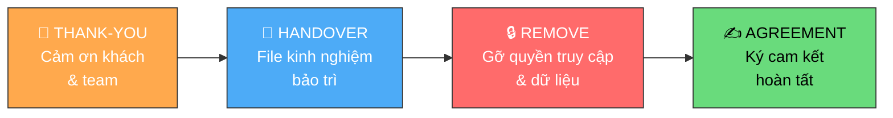

# Rời Dự Án — Quy trình cho Thành viên

**Người chịu trách nhiệm:** Product Owner
**Cập nhật lần cuối:** 2026-11-26
**Trạng thái:** Đang dùng

## Tại sao có trang này

Ở Cyberk, một thành viên có thể rời dự án bất cứ lúc nào mà dự án vẫn chạy tiếp. Nhờ quy trình Asimov, tri thức không nằm trong đầu một người: việc nằm trên board, code nằm trong PR, cách làm nằm trong handbook. Vì vậy rời dự án phải thật đơn giản, chỉ 4 bước `THANK-YOU → HANDOVER → REMOVE → AGREEMENT`: cảm ơn những người đã làm cùng, để lại kinh nghiệm bảo trì phần code mình viết, gỡ hết quyền truy cập, và ký cam kết đã làm đủ.

## Khi nào áp dụng (Trigger)

- Thành viên chủ động xin rời dự án.
- Ban Quản lý điều chuyển thành viên sang dự án khác.
- Thành viên nghỉ việc tại công ty.

---

## Luồng chính

---

## Vai trò & trách nhiệm

| Vai trò | Chịu trách nhiệm gì |
|---------|---------------------|
| **Product Owner** | Hướng dẫn thành viên viết lời cảm ơn và giải thích vì sao nên làm (*Thank-you*); đọc file kinh nghiệm bảo trì, đổi Assignee task còn mở (*Handover*); gỡ quyền repo, design file, group chat (*Remove*); gửi bản cam kết và chuyển HR lưu (*Agreement*) |
| **Thành viên rời đi** | Gửi lời cảm ơn tới khách và team (*Thank-you*); viết file kinh nghiệm bảo trì phần code mình viết (*Handover*); rời group, xoá source code và tài liệu trên máy (*Remove*); ký cam kết (*Agreement*) |
| **HR** | Lưu bản cam kết đã ký |

---

## Các bước

| # | Việc làm | Ai làm | Đầu ra | Timeline |
|---|----------|--------|--------|----------|
| 1 | **THANK-YOU — Cảm ơn khách hàng và team:** PO hướng dẫn thành viên viết một lời cảm ơn gửi khách hàng (external team) trong group `[Project] - Cyberk devs`, và một lời cảm ơn gửi team trong group nội bộ. PO nói rõ vì sao nên làm vậy: khách nhớ người đã làm cho họ bằng lời chào cuối, team biết công sức của nhau được ghi nhận, và cánh cửa quay lại dự án vẫn mở | Thành viên (viết) + PO (hướng dẫn) | Lời cảm ơn đã gửi trong group external và internal | Ngay khi chốt ngày rời |
| 2 | **HANDOVER — Viết file kinh nghiệm bảo trì:** Thành viên viết file **kinh nghiệm bảo trì** cho phần code mình viết theo [template](./template/maintenance-notes-template.md): code nằm ở đâu, chỗ nào dễ hỏng, việc cần làm định kỳ, việc còn dở. File đặt trong repo dự án, gửi qua PR. Task còn mở trên board: thành viên cập nhật Status và Notes, PO đổi Assignee | Thành viên (viết) + PO (đọc, đổi Assignee) | File kinh nghiệm bảo trì đã merge vào repo | Trước ngày làm việc cuối cùng |
| 3 | **REMOVE — Gỡ quyền truy cập và dữ liệu:** • Rời group Telegram: internal, external và các nhóm liên quan • Gỡ quyền vào repo • Gỡ quyền vào design file • Xoá source code ở máy local và các tài liệu liên quan | PO (gỡ quyền repo, design file, group) + Thành viên (xoá dữ liệu trên máy) | Không còn quyền truy cập, không còn dữ liệu dự án trên máy cá nhân | Ngày làm việc cuối cùng |
| 4 | **AGREEMENT — Ký cam kết hoàn tất:** Thành viên ký [Cam kết Hoàn tất Rời dự án](../../../policy/agreements/cyberk-member-leave-agreement.md), xác nhận đã làm đầy đủ bước Handover và Remove. PO gửi bản ký cho HR lưu | Thành viên (ký) + PO (gửi HR) | Cam kết đã ký, HR đã lưu | Ngày làm việc cuối cùng, sau Remove |

---

## Quy tắc cứng (không được vi phạm) + lý do

| Quy tắc | Lý do |
|---------|-------|
| Gửi lời cảm ơn trước khi Remove | Rời group rồi thì không còn chỗ để nói lời chào |
| Đầu ra của Handover là file kinh nghiệm bảo trì, viết theo template, nằm trong repo dự án | Người bảo trì sau mở repo là thấy, không cần đi tìm người cũ |
| Remove hoàn tất trong ngày làm việc cuối cùng | Không còn ai giữ quyền vào dự án mà mình không còn làm |
| Ký Agreement sau khi Handover và Remove đã xong | Cam kết xác nhận việc đã làm, không phải lời hứa sẽ làm |

---

## Ngoại lệ & Escalation

| Tình huống | Hành động |
|-----------|----------|
| **Nghỉ đột xuất** *(sức khoẻ, biến cố gia đình)* | PO gỡ quyền ngay trong ngày. Thành viên viết file kinh nghiệm bảo trì khi có thể. Nếu không viết được, PO ghi lại những gì biết từ board và PR |
| **File kinh nghiệm bảo trì còn thiếu** *(chỉ liệt kê file, không có chỗ dễ hỏng)* | PO hỏi lại và yêu cầu bổ sung trước ngày làm việc cuối cùng |
| **Thành viên ngắt liên lạc hoặc không ký cam kết** | PO gỡ toàn bộ quyền ngay, báo **Anderson** để xử lý theo chính sách công ty |

---

## Checklist

- [ ] **Thank-you:** Đã gửi lời cảm ơn trong group external `[Project] - Cyberk devs` và group internal
- [ ] **Handover:** File kinh nghiệm bảo trì đã merge vào repo, task còn mở đã đổi Assignee
- [ ] **Remove:** Đã rời mọi group Telegram của dự án (internal, external, nhóm liên quan)
- [ ] **Remove:** Đã gỡ quyền repo và design file
- [ ] **Remove:** Đã xoá source code và tài liệu dự án trên máy local
- [ ] **Agreement:** Đã ký cam kết, HR đã lưu

---

## Liên kết

- [Template kinh nghiệm bảo trì](./template/maintenance-notes-template.md)
- [Cam kết Hoàn tất Rời dự án](../../../policy/agreements/cyberk-member-leave-agreement.md)
- [Cẩm nang Rời Dự Án cho Product Owner](./member-leave-lead-handbook.md)
- [Cẩm nang Rời Dự Án cho Thành viên](./member-leave-member-handbook.md)
- [Nhóm chat của dự án](../../00-account/team-chat-groups/chat-groups-handbook.md)
