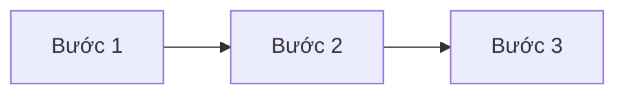

# Tạo Milestone mới trên Board

**Người chịu trách nhiệm:** PO dự án
**Cập nhật lần cuối:** 2026-11-26
**Trạng thái:** Nháp

## Tại sao có trang này

[Chờ thảo luận]

## Khi nào áp dụng (Trigger)

[Chờ thảo luận: dựng board từ Planning Report / khách chốt thêm đợt việc / Feature Request đã được duyệt]

---

## Luồng chính

---

## Vai trò & trách nhiệm

| Vai trò | Chịu trách nhiệm gì |
|---------|---------------------|
| | |

---

## Các bước

| # | Việc làm | Ai làm | Đầu ra | Timeline |
|---|----------|--------|--------|----------|
| 1 | | | | |

---

## Quy tắc cứng (không được vi phạm) + lý do

| Quy tắc | Lý do |
|---------|-------|
| | |

---

## Ngoại lệ & Escalation

| Tình huống | Hành động |
|-----------|----------|
| | |

---

## Checklist

- [ ] ...

---

## Liên kết

- [Cẩm nang Tạo Milestone](./milestone-create-handbook.md)
- [Mẫu Milestone & Task](./milestone-create-example.md)
