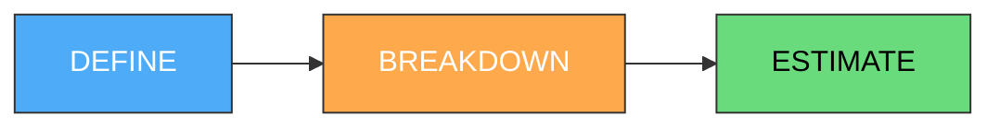

# Tạo Milestone mới từ yêu cầu

**Người chịu trách nhiệm:** PO dự án
**Cập nhật lần cuối:** 2026-11-26
**Trạng thái:** Nháp

## Tại sao có trang này

Mọi con số sau này của dự án đều bắt đầu từ đây: báo giá gửi khách, số người cần cho team, ngày bàn giao. Một Milestone được phân tích vội thường rơi vào một trong hai chuyện. Một là **thiếu hạng mục**: task chỉ có luồng chạy đúng, không có UX/UI, QA, xử lý lỗi, nên Estimate thấp hơn thực tế và team phải gánh phần chênh lệch. Hai là **tên mơ hồ**: một Milestone tên `Backend` hay `Phase 2` thì không ai hình dung ra bên trong phải làm gì, kể cả người đã estimate nó.

Quy trình này đi từ yêu cầu của khách tới ba thứ: **tên Milestone, danh sách task, và số giờ của từng task.** Quy trình không cần team dự án đã được thành lập, vì việc estimate thường diễn ra từ lúc làm proposal, trước khi có team.

## Khi nào áp dụng (Trigger)

Mỗi khi cần một Milestone mới:
- Làm proposal hoặc báo giá cho khách, trước khi ký hợp đồng.
- Dựng board sau khi ký hợp đồng, từ PRD *(xem [Khởi tạo Board](../po-board-create/board-create-process.md))*.
- Khách chốt một [Feature Request](../po-feature-request/feature-request-process.md) đã có BRD.
- Buổi [Internal Daily](../po-internal-daily/internal-daily-process.md) phát hiện một đợt việc lớn hơn vài task lẻ.

---

## Luồng chính

---

## Vai trò & trách nhiệm

| Vai trò | Chịu trách nhiệm gì |
|---------|---------------------|
| **Product Owner (PO)** | Phân tích yêu cầu và đặt tên Milestone (*Define*); tách Milestone thành task (*Breakdown*); ngồi cùng Tech Lead ghi số giờ và cộng tổng (*Estimate*) |
| **Tech Lead / Dev có kinh nghiệm** | Chỉ ra hạng mục kỹ thuật còn thiếu, tách nhỏ task quá 4 tiếng (*Breakdown*); ước lượng số giờ từng task (*Estimate*) |

---

## Các bước

| # | Việc làm | Ai làm | Đầu ra | Timeline |
|---|----------|--------|--------|----------|
| 1 | **DEFINE — Phân tích yêu cầu & đặt tên Milestone:** PO đọc đầu vào *(proposal, PRD, BRD của Feature Request, hoặc ghi chú buổi Demo)* và trả lời: Milestone này xong thì khách dùng được gì mới? Từ câu trả lời đó, đặt tên theo dạng **đối tượng + việc cần làm** *(VD `Lighter Platform Integration`)*, rồi viết 1–2 câu mô tả phạm vi. Kiểm độ lớn: 1 người hoặc team dưới 5 người làm dưới 1 tuần. Lớn hơn thì tách thành 2 Milestone | PO | **Tên Milestone** + **mô tả phạm vi 1–2 câu** | Ngay khi có đầu vào |
| 2 | **BREAKDOWN — Tách Milestone thành task:** PO cùng Tech Lead liệt kê các task để hoàn thành Milestone: • Các task cho luồng chạy đúng • Task xử lý lỗi *(dữ liệu sai, server lỗi, giao dịch treo...)* • 1 task UX/UI, 1 task QA, 1 task Code Refactor Mỗi task không quá 4 tiếng, tên task viết sao cho khách đọc là hiểu | PO + Tech Lead | **Danh sách task** của Milestone | Sau DEFINE |
| 3 | **ESTIMATE — Ước lượng số giờ:** PO ngồi cùng Tech Lead đi qua từng task, ghi số giờ vào cột **Estimate (h)**, rồi cộng tổng giờ của cả Milestone. Ghi **số giờ thật, chưa cộng buffer** — buffer cộng ở bước báo giá *(VD bước Estimate của [Feature Request](../po-feature-request/feature-request-process.md))* | PO + Tech Lead | **Bảng `Milestones · Tasks · Estimate (h)`** + **tổng giờ** của Milestone, sẵn sàng dán vào board hoặc đưa vào proposal | Sau BREAKDOWN |

---

## Quy tắc cứng (không được vi phạm) + lý do

| Quy tắc | Lý do |
|---------|-------|
| Tên Milestone gồm đối tượng cụ thể + việc cần làm | Đọc tên là hình dung ra việc phải làm |
| Milestone đạt [Board Rule](../po-board-create/board-create-process.md): đủ task UX/UI, QA, Code Refactor, mỗi task không quá 4 tiếng | Một luật, một nơi: Board Rule nằm ở quy trình Khởi tạo Board và tab `README` của Sheet |
| Mọi task có Estimate (h) | Tổng giờ của Milestone là con số để báo giá và lên kế hoạch |
| PO estimate cùng Tech Lead hoặc Dev có kinh nghiệm | Người làm kỹ thuật thấy được những hạng mục PO không thấy |

---

## Ngoại lệ & Escalation

| Tình huống | Hành động |
|-----------|----------|
| **Chưa có team dự án** *(đang làm proposal)*, hoặc Dev **chưa ngồi estimate kịp** vì đang chạy dự án khác | Estimate cùng Tech Lead hoặc một senior của Team Asimov. Nếu vẫn chưa có ai, PO estimate nháp, ghi `Chờ Dev xác nhận` ở cột Notes. Dev nhận task xem lại Estimate ở bước Assign của [Khởi tạo Board](../po-board-create/board-create-process.md). Mọi task luôn có số Estimate |
| Yêu cầu **còn mơ hồ**, chưa trả lời được "xong thì khách dùng được gì" | Dừng ở DEFINE. Hỏi lại khách, hoặc viết BRD theo [mẫu BRD](../po-feature-request/template/feature-request-brd-template.md) trước khi tách task |
| Task **không tách được dưới 4 tiếng** *(research, tích hợp bên thứ ba chưa rõ tài liệu)* | Tạo trước một task research ≤ 4 tiếng. Đầu ra là một bản báo cáo: có những cách giải quyết nào, chọn cách nào và tại sao *(link ở cột Notes)*. Có cách đã chọn rồi mới estimate phần làm thật |
| Milestone **lớn hơn 1 tuần** sau khi cộng Estimate | Quay lại DEFINE, tách thành 2 Milestone, mỗi cái có tên và phạm vi riêng |
| Tổng giờ **vượt ngân sách hoặc timeline** đã trao đổi với khách | Báo **AM (Anderson / Brian)** trước khi gửi số cho khách |

---

## Checklist mỗi Milestone

- [ ] **Define:** Tên Milestone có đối tượng + việc cần làm, có mô tả phạm vi 1–2 câu, Milestone làm được dưới 1 tuần
- [ ] **Breakdown:** Có đủ task cho luồng chạy đúng, xử lý lỗi, UX/UI, QA, Code Refactor; không task nào quá 4 tiếng; tên task khách đọc là hiểu
- [ ] **Estimate:** Đã ngồi cùng Tech Lead, mọi task có Estimate (h), đã cộng tổng giờ của Milestone

---

## Liên kết

- [Cẩm nang Tạo Milestone](./milestone-create-handbook.md) — Độ lớn, cách đặt tên, tách task, estimate cùng Tech Lead
- [Mẫu Milestone & Task](./milestone-create-example.md) — Mẫu tốt/chưa tốt
- [Khởi tạo Board](../po-board-create/board-create-process.md) — Đưa Milestone lên board, Assign và Plan
- [Feature Request](../po-feature-request/feature-request-process.md) — Khi Milestone mới đến từ yêu cầu của khách
