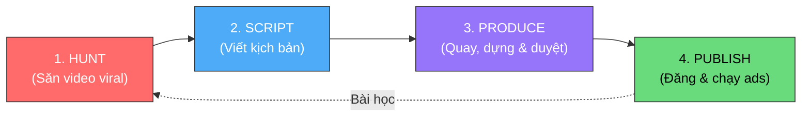

# 🎬 Cẩm Nang Team Media (Media Handbook)

Tại Cyberk, mỗi ngày đều có chuyện đáng kể: một buổi demo cho khách, một bug khó vừa fix, một feature vừa ship. **Team Media biến những công việc sản phẩm thường ngày đó thành video** để người xem thấy Cyberk làm sản phẩm như thế nào.

Mỗi video đi qua đúng 4 chặng: **`HUNT → SCRIPT → PRODUCE → PUBLISH`**. Nếu bạn mới vào team Media, đọc tuần tự từ **Chương 1 đến Chương 4**. Mỗi chương đều đi từ **Quy trình (`Process`)** → **Cẩm nang (`Handbook`)** → **Mẫu (`Example`)**.

> **Quy trình có trước, người lấp dần sau.**
> Team Media còn nhỏ, một người có thể kiêm nhiều vai. Không sao cả. Điều bắt buộc là ở mỗi chặng ai cũng biết **ai đang chịu trách nhiệm**. Xem [Vai trò team Media](./media-team-role.md).

---

## 🗺️ Hành trình của một video

### Chỉ một bước duyệt, ngay trước khi đăng

Cả quy trình chỉ có **một bước REVIEW**: duyệt video ở đầu chặng PUBLISH, ngay trước khi đăng. Content Writer chốt, Anderson góp ý. Các chặng khác không chờ ai duyệt: Content Writer tự lọc lúc xem, Content Writer tự soát rồi đẩy thẳng sang quay, Editor dựng xong là gửi duyệt. **Chạy trước, lỗi đâu sửa đó**, để không có ngày chết nào vì chờ duyệt.

> **Quy tắc:** Người duyệt không phải người làm. Content Writer tự quay hoặc dựng clip đó thì Anderson chốt thay.

| Chặng | Luồng | Người chịu trách nhiệm | Đầu ra |
|-------|-------|------------------------|--------|
| **HUNT** | `SCROLL → DECODE → TEXT` | Content Writer | Video viral `done` (giải mã + text gốc) trong bảng HUNT |
| **SCRIPT** | `IDEAS → CONTENT` | Content Writer | Kịch bản `Đã xong` trong tab SCRIPT |
| **PRODUCE** | `SHOOT → PACK → EDIT` | Media Manager | Bản dựng hoàn chỉnh, source trên NAS |
| **PUBLISH** | `REVIEW → POST → BOOST` | Content Writer | Video đã duyệt và đăng; số liệu, ads, bài học quay về HUNT và SCRIPT |

> **Content Writer** làm cả 3 việc: săn video viral (HUNT), viết kịch bản (SCRIPT), duyệt và đăng (PUBLISH). Xem [Một ngày của Content Writer](./content-writer-daily-process.md).

---

## 📖 Mục Lục Thứ Tự Đọc

#### Chương 1: Săn Video Viral ([`media-hunt/`](./media-hunt/))
> *Content Writer đi săn video trên 500k views, giải mã vì sao chúng viral, chép nguyên văn text gốc về cho team viết lại.*

| Thứ tự | Bài đọc | Loại | Nội dung cốt lõi |
|:------:|---------|------|------------------|
| **1.1** | [Quy trình Săn video viral](./media-hunt/hunt-process.md) | Process | Luồng `SCROLL → DECODE → TEXT` |
| **1.2** | [Săn video viral — Cẩm nang cho Content Writer](./media-hunt/hunt-handbook.md) | Handbook | Lướt và lọc có chủ đích, giải mã Hook & Why Viral, chép text-script gốc |
| **1.3** | [Mẫu ghi video viral](./media-hunt/hunt-example.md) | Example | Điền bảng HUNT: tốt vs tồi |

#### Chương 2: Viết Kịch Bản ([`media-script/`](./media-script/))
> *Ghép chuyện thật Cyberk cần kể vào khung viral, viết thành kịch bản VJ cầm lên quay được ngay.*

| Thứ tự | Bài đọc | Loại | Nội dung cốt lõi |
|:------:|---------|------|------------------|
| **2.1** | [Quy trình Viết kịch bản](./media-script/script-process.md) | Process | Luồng `IDEAS → CONTENT` |
| **2.2** | [Viết kịch bản — Cẩm nang cho Content Writer](./media-script/script-handbook.md) | Handbook | Mượn khung không mượn chuyện, hook, kể bằng trải nghiệm, phần hình |
| **2.3** | [Mẫu kịch bản](./media-script/script-example.md) | Example | Kịch bản tốt vs tồi |
| **2.4** | [Khung nội dung A1–A4](./media-script/script-frames-reference.md) | Reference | Product Walkthrough, Core Value, Workplace, Dumb & Trendy |

#### Chương 3: Quay & Dựng ([`media-produce/`](./media-produce/))
> *Từ kịch bản ra bản dựng hoàn chỉnh: quay, lưu source lên NAS, dựng tinh.*

| Thứ tự | Bài đọc | Loại | Nội dung cốt lõi |
|:------:|---------|------|------------------|
| **3.1** | [Quy trình Quay & Dựng](./media-produce/produce-process.md) | Process | Luồng `SHOOT → PACK → EDIT` |
| **3.2** | [Quay & Dựng — Cẩm nang](./media-produce/produce-handbook.md) | Handbook | Quay sao cho dễ dựng (kể cả trang phục khi quay), dựng đúng ý kịch bản |
| **3.3** | [Quản lý Nguồn Media & NAS](./media-produce/source-management-policy.md) | Policy | Chuẩn đóng gói source, đặt tên file, cấu trúc NAS |

#### Chương 4: Duyệt, Đăng & Chạy Ads ([`media-publish/`](./media-publish/))
> *Duyệt video ngay trước khi đăng, đưa video tới đúng người xem, chạy ads cho video đã chứng minh được là tốt, rút bài học về lại HUNT.*

| Thứ tự | Bài đọc | Loại | Nội dung cốt lõi |
|:------:|---------|------|------------------|
| **4.1** | [Quy trình Đăng & Chạy ads](./media-publish/publish-process.md) | Process | Luồng `REVIEW → POST → BOOST` |
| **4.2** | [Duyệt, Đăng & Chạy ads — Cẩm nang](./media-publish/publish-handbook.md) | Handbook | Review cái gì trước, góp ý để Editor sửa được ngay, caption, đọc số liệu, khi nào chạy ads |

---

## 🧰 Tài liệu dùng chung

- [Vai trò team Media](./media-team-role.md): ai làm gì, ai kiêm vai nào, bàn giao giữa các chặng
- [Một ngày của Content Writer](./content-writer-daily-process.md): HUNT → IDEAS → SCRIPT mỗi ngày *(nháp)*
