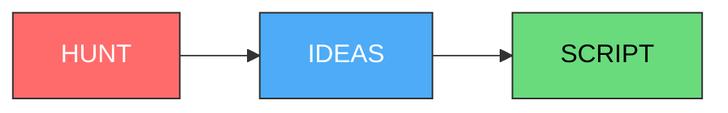

# Làm việc một ngày của Content Writer

**Người chịu trách nhiệm:** Anderson
**Cập nhật lần cuối:** 2026-11-28
**Trạng thái:** Nháp

> 📝 Trang ghi nhanh để khỏi quên. Anderson sẽ bổ sung và hoàn thiện sau.

## Tại sao có trang này

> 📝 TODO

## Khi nào áp dụng (Trigger)

Mỗi ngày làm việc của Content Writer.

---

## Luồng chính

---

## Các bước

| # | Việc làm | Đầu ra |
|---|----------|--------|
| 1 | **HUNT — Săn video:** Lựa **5 video tiềm năng**, làm theo [quy trình săn video viral](./media-hunt/hunt-process.md) | 5 video đã giải mã trong bảng HUNT |
| 2 | **IDEAS — Nghiên cứu Cyberk, tìm chuyện đáng để kể:** Content Writer không làm dự án, nhưng phải hiểu việc các dự án đang làm: phỏng vấn anh em, xem demo dự án, đi họp, lấy tài liệu, nhận ra cái gì hay Xem bước IDEAS trong [quy trình viết kịch bản](./media-script/script-process.md) | Idea mới trong tab `ideas` |
| 3 | **SCRIPT — Viết kịch bản:** Viết thành kịch bản theo [quy trình viết kịch bản](./media-script/script-process.md) | Kịch bản trên Figma |

---

## Checklist cuối ngày

- [ ] Đã săn và giải mã 5 video tiềm năng
- [ ] Đã thu thập chất liệu mới từ Cyberk
- [ ] Đã viết kịch bản
- [ ] 📝 TODO

---

## Liên kết

- [Săn video viral](./media-hunt/hunt-process.md)
- [Viết kịch bản](./media-script/script-process.md)
- [Vai trò team Media](./media-team-role.md)
