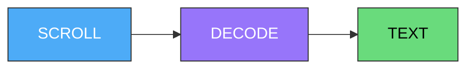

# Săn video viral trên TikTok

**Người chịu trách nhiệm:** Content Writer
**Cập nhật lần cuối:** 2026-11-28
**Trạng thái:** Nháp

## Tại sao có trang này

Mỗi video trên 500k views là **một thí nghiệm đã chạy xong**: hook này giữ được người xem, nhịp này khiến người ta xem tới cuối. Quy trình này biến việc lướt TikTok thành một kho video viral đã giải mã, kèm nguyên văn text gốc, để chặng [SCRIPT](../media-script/script-process.md) viết lại bằng chuyện thật của Cyberk. Cách nghĩ đằng sau: xem [Cẩm nang săn video viral](./hunt-handbook.md).

Một video săn về chỉ có giá trị khi đạt 3 điều:

1. **Đã viral thật và dùng được cho Cyberk:** trên 500k views, khung kể có chỗ cho chuyện thật của Cyberk, nội dung không làm xấu hình ảnh Cyberk.
2. **Đã được giải mã:** có Hook và Why Viral, ai đọc cũng hiểu vì sao nó viral mà không cần mở lại video.
3. **Có text-script gốc:** chép nguyên văn theo từng cảnh, mỗi cảnh ghi rõ vai trò, kèm chuyện Cyberk kể được theo khung đó.

> 📋 **Bảng output của Content Writer:** tab **HUNT** trong Google Sheet `Media-Team` ([mở bảng](https://docs.google.com/spreadsheets/d/1coHEhiNpW9bvqZFh3xiozlcXkS3iJjGUTVXe7DOnNFE/edit?gid=1286752102#gid=1286752102)). Điền **đúng cột và đúng thứ tự** của bảng:

| Cột | Bước | Điền gì |
|-----|------|---------|
| **Link** | SCROLL | Link video TikTok |
| **Hook** | DECODE | 3 giây đầu video làm gì để người xem không lướt qua |
| **Why Viral** | DECODE | Vì sao video viral: **lời hứa** của 3 giây đầu, **chỗ khơi lại sự chú ý** (giây thứ mấy), cấu trúc, nhịp, cách kết, gói lại thành lý do chính |
| **Text per Scence** | TEXT | Text-script gốc chép nguyên văn, **chia theo từng cảnh**: thời gian, lời thoại, chữ trên màn hình, vai trò của cảnh |
| **Ideas** | TEXT | Chuyện thật nào của Cyberk kể được theo khung này |
| **Status** | Cả 3 bước | `todo` → `doing` → `done` (hoặc `canceled`) |
| **Notes** | Cả 3 bước | Số view, ngày đăng, ghi chú khác (VD: `đang lên`) |

## Khi nào áp dụng (Trigger)

- **Mỗi ngày:** Content Writer lướt TikTok có chủ đích, lựa ra **5 video tiềm năng** (xem [Một ngày của Content Writer](../content-writer-daily-process.md)).
- **Bất cứ lúc nào:** ai ở Cyberk lướt thấy video viral hợp với Cyberk thì thả link vào kho, Content Writer giải mã tiếp.

---

## Luồng chính

---

## Vai trò & trách nhiệm

| Vai trò | Chịu trách nhiệm gì |
|---------|---------------------|
| **Content Writer** | Lướt và lọc video (*Scroll*); giải mã vì sao viral (*Decode*); chép text-script gốc (*Text*) |
| **Người có ý tưởng** (bất kỳ ai ở Cyberk) | Thả link video viral vào kho (*Scroll*), không cần giải mã |

---

## Các bước

| # | Việc làm | Ai làm | Đầu ra |
|---|----------|--------|--------|
| 1 | **SCROLL — Lướt và lọc:** Lướt TikTok có chủ đích, không phải lướt giải trí. Lọc ngay khi xem, chỉ giữ video đạt cả 3: • **Trên 500k views** *(đề xuất: đăng trong 3 tháng gần nhất)* • **Khung có chỗ cho chuyện thật của Cyberk:** khung thử thách cần một thử thách thật, khung trước/sau cần một sự thay đổi thật • **Không làm xấu hình ảnh Cyberk:** không nhảm, không phản cảm, không dính chính trị, không động tới quyền lợi của người khác Không giới hạn ở video công nghệ: khung của video nấu ăn, thử thách, vlog vẫn dùng được. Điền cột **Link**, ghi số view vào **Notes**, **Status** = `todo` | Content Writer, người có ý tưởng | Cột Link |
| 2 | **DECODE — Giải mã vì sao viral:** Điền 2 cột: • **Hook:** 3 giây đầu làm gì để người xem không lướt qua • **Why Viral:** vì sao video viral. Ghi rõ: &nbsp;&nbsp;– **Lời hứa:** 3 giây đầu hứa với người xem điều gì, và video giữ lời hứa đó ở giây thứ mấy &nbsp;&nbsp;– **Chỗ khơi lại sự chú ý:** giây thứ mấy có twist, reveal hay điểm mới để người xem không lướt đi &nbsp;&nbsp;– Cấu trúc (trình tự video), nhịp (bao lâu cắt một lần, chữ, nhạc), cách kết Rồi gói lại thành lý do chính **Status** = `doing` | Content Writer | Cột Hook, Why Viral |
| 3 | **TEXT — Chép text-script gốc:** Điền 2 cột: • **Text per Scence:** chép nguyên văn lời thoại và chữ trên màn hình, **chia theo từng cảnh**. Mỗi cảnh ghi: thời gian, lời, chữ trên màn hình, **vai trò** (hook, đặt vấn đề, mồi tò mò, twist, giải pháp, kết...). 📝 TODO: công cụ lấy text (VD: caption tự động của TikTok, AI transcribe) • **Ideas:** chuyện thật nào của Cyberk kể được theo khung này **Status** = `done` | Content Writer | Cột Text per Scence, Ideas; video `done` |

> **Xong TEXT là tự sang SCRIPT.** Video ở Status `done` là Content Writer dùng được ngay ở bước CONTENT, không cần chờ ai cho phép.

---

## Quy tắc cứng (không được vi phạm) + lý do

| Quy tắc | Lý do |
|---------|-------|
| **Chỉ giữ video trên 500k views** | Dưới ngưỡng đó, chưa chắc khung kể là lý do video được xem. Trên 500k thì thuật toán và người xem đã chứng minh giúp mình |
| **Lọc ngay khi xem:** video nhảm, phản cảm, dính chính trị, động tới quyền lợi của người khác, hoặc khung không có chỗ cho chuyện Cyberk thì không lưu, dù view cao đến đâu | Kho chỉ chứa video dùng được. Lưu cả video không dùng được thì Content Writer mất thời gian lọc lại |
| **Không có video nào ở `done` mà còn trống cột Hook, Why Viral, Text per Scence hoặc Ideas** | Link trơn kèm "video này hay" thì một tuần sau không ai nhớ nó hay ở đâu, không ai dùng được |
| **Text gốc phải chép nguyên văn, chia theo từng cảnh, mỗi cảnh có vai trò** | Chặng SCRIPT viết kịch bản Cyberk **từ chính text gốc**, đi từng cảnh. Thứ giữ người xem nằm ở từng câu, từng cảnh: câu dài hay ngắn, ngắt ở đâu, con số đặt chỗ nào. Tóm tắt thì mất hết những thứ đó |
| **Text gốc chỉ dùng nội bộ để học.** Không đăng lại, không chia sẻ ra ngoài | Lời thoại là của người làm video gốc. Cyberk học cách họ kể, không lấy lời của họ |
| **Kho luôn có ít nhất 10 video `done`** *(đề xuất)* | Kho cạn thì chặng SCRIPT phải tự đoán khung, quay lại đúng vấn đề kể dở |

---

## Ngoại lệ & Escalation

| Tình huống | Hành động |
|-----------|----------|
| Video viral thật nhưng chưa tới 500k views (VD: mới đăng 2 ngày đã 300k) | Được giữ, ghi `đang lên` và lý do vào cột **Notes** |
| Video không có lời thoại (chỉ nhạc + hình) | Trong **Text per Scence**, ghi chữ trên màn hình và mô tả từng cảnh thay cho lời thoại |
| Kho còn dưới 10 video `done` | Content Writer báo tại New Media Meeting, cả team cùng thả link trong tuần |
| Đang giải mã mới thấy video không dùng được cho Cyberk | **Status** = `canceled`, ghi một dòng lý do vào **Notes** |
| Phân vân video có hợp hình ảnh Cyberk không | Hỏi Anderson trước khi lưu |

---

## Checklist

### SCROLL
- [ ] Video trên 500k views, khung có chỗ cho chuyện Cyberk, không làm xấu hình ảnh Cyberk
- [ ] Đã điền **Link**, số view trong **Notes**, **Status** = `todo`

### DECODE
- [ ] **Hook** và **Why Viral** (lời hứa, chỗ khơi lại sự chú ý, cấu trúc, nhịp, cách kết), **Status** = `doing`

### TEXT
- [ ] **Text per Scence** chép nguyên văn theo từng cảnh, mỗi cảnh có vai trò
- [ ] Đã điền **Ideas**, **Status** = `done`
- [ ] Kho còn ít nhất 10 video `done`

---

## Liên kết

- [Cẩm nang săn video viral](./hunt-handbook.md)
- [Mẫu ghi video viral](./hunt-example.md)
- [Vai trò team Media](../media-team-role.md)
- [Chặng tiếp theo: Viết kịch bản](../media-script/script-process.md)
