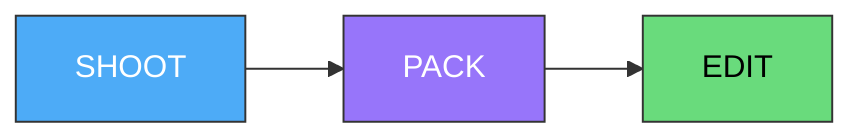

# Quay và dựng video từ kịch bản

**Người chịu trách nhiệm:** Media Manager (Editor Lead)
**Cập nhật lần cuối:** 2026-11-28
**Trạng thái:** Nháp

> 📋 **Output của chặng PRODUCE:** tab **PRODUCE** trong Google Sheet `Media-Team` ([mở bảng](https://docs.google.com/spreadsheets/d/1coHEhiNpW9bvqZFh3xiozlcXkS3iJjGUTVXe7DOnNFE/edit)). Mỗi video là một hàng:
>
> | Cột | Bước | Ai điền | Điền gì |
> |-----|------|---------|---------|
> | **Video** | SHOOT | VJ | Đúng **Tên video** bên tab SCRIPT |
> | **Input Source URI** | PACK | Editor | Đường dẫn gói source trên NAS `sources/YYYY-MM-DD/...` |
> | **Thumpnail** | EDIT | Editor | Link thumbnail |
> | **Output source URI** | REVIEW (đầu PUBLISH) | Editor | Đường dẫn file final trên NAS `social/`, sau khi video được duyệt |
> | **Date** | REVIEW (đầu PUBLISH) | Editor | Ngày video final được chốt |
>
> Ngoài ra: VJ tick **Đã quay**, Editor tick **Đã dựng** ở tab SCRIPT, và cập nhật *Số vid source chưa dựng* ở tab Lịch đẩy vid (+N khi quay xong, −N khi dựng xong).

## Tại sao có trang này

Kịch bản hay vẫn có thể thành video dở nếu quay thiếu cảnh, thiếu sáng, source thất lạc, hoặc Editor dựng sai ý.

Quy trình này nối VJ và Editor thành một luồng liền mạch, từ lúc bấm máy đến lúc có **bản dựng hoàn chỉnh**, sẵn sàng cho bước duyệt ngay trước khi đăng ở đầu chặng [PUBLISH](../media-publish/publish-process.md). Mục tiêu đã ghi trên tab Lịch đẩy vid: **trong tuần phải quay và dựng xong video của tuần tiếp theo**.

## Khi nào áp dụng (Trigger)

Kịch bản đã ở trạng thái `Đã xong` trong tab SCRIPT (cuối chặng [Viết kịch bản](../media-script/script-process.md)), có lịch quay trong cột *Cần kiểm tra / ghi chú*.

---

## Luồng chính

---

## Vai trò & trách nhiệm

| Vai trò | Chịu trách nhiệm gì |
|---------|---------------------|
| **Media Manager** | Giữ nhịp chặng PRODUCE: đủ video cho tuần sau, cột *Số vid source chưa dựng* không dồn ứ |
| **VJ** | Quay theo kịch bản (*Shoot*); dựng thô, đóng gói, bàn giao cho Editor (*Pack*) |
| **Editor** | Lưu source lên NAS công ty đúng quy chuẩn (*Pack*); dựng hoàn chỉnh, gửi bản dựng (*Edit*). Ở đầu chặng PUBLISH: sửa theo góp ý, export final |

---

## Các bước

| # | Việc làm | Ai làm | Đầu ra |
|---|----------|--------|--------|
| 1 | **SHOOT — Quay:** Quay đủ mọi SCENE theo cột Kịch Bản: đúng Visual, đọc đúng VO (được nói theo giọng mình, giữ nguyên ý). Trước khi bấm máy: • Mặc đúng [trang phục khi quay](./produce-handbook.md#trang-phục-khi-quay) • Quay ở **góc quay cố định** tại công ty, **ưu tiên ban ngày** để có ánh sáng tự nhiên; quay trong văn phòng thì **thêm đèn** • Người nói luôn có mặt trong khung hình (góc màn hình hoặc split-screen), không cắt khỏi người nói quá lâu Câu VO nào nói không được thì sửa tại chỗ, ghi lại để Content Writer cập nhật kịch bản, **trừ câu `[HOOK – KHÔNG ĐỔI]`: nói đúng từng chữ**. **Quay dư:** cả hậu trường và những lần quay hỏng, để có b-roll lưu trên NAS. Quay xong: thêm hàng mới ở tab PRODUCE, điền **Video**; tick **Đã quay**, **+1** vào *Số vid source chưa dựng* | VJ | Footage thô đủ mọi SCENE |
| 2 | **PACK — Lưu source lên NAS công ty đúng quy chuẩn:** VJ dựng thô để Editor nắm nhịp, đóng gói theo [quy chuẩn NAS](./source-management-policy.md) (folder `YYYY-MM-DD/ten-du-an_ten-vj_ten-clip/` gồm `source/`, file dựng thô `.mp4`/`.mov`, file kịch bản copy từ cột Kịch Bản) và bàn giao cho Editor qua Telegram. **Editor lưu gói lên NAS công ty tại `sources/YYYY-MM-DD/`**, gộp chung folder ngày nếu đã có, rồi điền đường dẫn vào cột **Input Source URI** | VJ (đóng gói) → Editor (lưu NAS) | Gói source đúng chuẩn, nằm trên NAS `sources/` |
| 3 | **EDIT — Dựng hoàn chỉnh:** Dựng tinh theo Visual và Sound của kịch bản: popup text, motion graphics, nhạc, hiệu ứng, màu. Làm thumbnail đúng chuẩn (căn lề, cỡ chữ nhất quán, **có logo Cyberk**), **cùng lời hứa với hook và Tên video**, điền link vào cột **Thumpnail**. Công cụ AI (tìm stock footage, motion, font) được dùng, nhưng **Editor phải xem lại output trước khi đưa vào video**. Gửi link bản dựng cho Content Writer & Anderson qua Telegram | Editor | Bản dựng chờ review + thumbnail |

> **Xong EDIT là tự sang PUBLISH.** Editor đã gửi link bản dựng là bước REVIEW ở đầu chặng PUBLISH bắt đầu, không cần chờ ai cho phép.

---

## Quy tắc cứng (không được vi phạm) + lý do

| Quy tắc | Lý do |
|---------|-------|
| **Quay đủ mọi SCENE trong kịch bản** trước khi đóng gói | Thiếu một cảnh là phải hẹn quay lại, cả dây chuyền chờ |
| **Mọi source phải nằm trên NAS công ty, đủ 3 thành phần, đặt tên đúng chuẩn.** Không giữ source riêng trên máy cá nhân hay gửi file qua Telegram | Source mất là không dựng lại hay tái sử dụng được. Xem thêm lý do trong [quy chuẩn NAS](./source-management-policy.md) |
| **Output của công cụ AI phải được Editor xem lại** trước khi đưa vào video | AI tìm stock footage và làm motion nhanh, nhưng dễ ra hình lệch ý hoặc trông "slop". Video gắn với tên Cyberk |
| **Câu hook nói đúng từng chữ như kịch bản** | Câu mở đầu quyết định ai ở lại, đã được viết kỹ từ trước. Các câu VO khác được nói theo giọng VJ |
| **Thumbnail và hook phải hứa cùng một điều** | Thumbnail hứa một đằng, video mở đầu một nẻo thì người xem thấy bị lừa và bấm thoát ngay |
| **Thumbnail căn lề, cỡ chữ nhất quán, có logo Cyberk** | Thumbnail cũ lệch, cỡ chữ lung tung, không có logo; người xem không nhận ra là kênh Cyberk |
| **Tab PRODUCE, cột Đã quay, Đã dựng và *Số vid source chưa dựng* phải cập nhật ngay** khi xong việc | Media Manager nhìn bảng là biết tuần sau đủ video chưa, không phải hỏi |

---

## Ngoại lệ & Escalation

| Tình huống | Hành động |
|-----------|----------|
| Tới buổi quay mới thấy một cảnh không quay được (thiếu người, đồ, địa điểm) | Quay các cảnh còn lại. Báo Content Writer ngay để sửa cảnh đó hoặc hẹn quay bù. Không tự bỏ cảnh |
| Editor không hiểu ý một SCENE | Hỏi Content Writer qua Telegram, kèm số SCENE. Không tự đoán |
| *Số vid source chưa dựng* dồn ứ, Editor không kịp dựng | Media Manager báo tại New Media Meeting, điều chỉnh lịch quay tuần sau |
| Không đủ video cho tuần sau | Media Manager báo tại New Media Meeting, kéo thêm kịch bản `Đã xong` lên quay |

---

## Checklist

### SHOOT
- [ ] Trang phục đúng; góc quay cố định, đủ sáng
- [ ] Đã quay đủ mọi SCENE, quay dư hậu trường; câu hook nói đúng từng chữ
- [ ] Câu VO sửa tại chỗ đã ghi lại cho Content Writer
- [ ] Đã thêm hàng ở tab PRODUCE (**Video**), tick **Đã quay**, +1 vào *Số vid source chưa dựng*

### PACK
- [ ] VJ: gói đủ `source/` + dựng thô + kịch bản, đặt tên đúng chuẩn, đã bàn giao
- [ ] Editor: đã lưu lên NAS `sources/YYYY-MM-DD/`, điền **Input Source URI**

### EDIT
- [ ] Dựng đúng Visual và Sound của kịch bản; output AI đã xem lại
- [ ] Thumbnail đúng chuẩn, có logo, cùng lời hứa với hook; đã điền **Thumpnail**
- [ ] Đã gửi link bản dựng cho Content Writer & Anderson

---

## Liên kết

- [Cẩm nang Quay & Dựng](./produce-handbook.md)
- [Quản lý Nguồn Media & NAS](./source-management-policy.md)
- [Chặng trước: Viết kịch bản](../media-script/script-process.md)
- [Chặng tiếp theo: Đăng & Chạy ads](../media-publish/publish-process.md)
