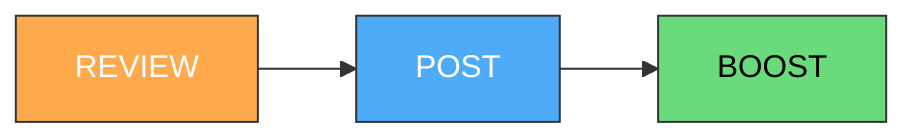

# Duyệt, đăng video, chạy ads và rút bài học

**Người chịu trách nhiệm:** Content Writer
**Cập nhật lần cuối:** 2026-11-28
**Trạng thái:** Nháp

> 📋 **Output của chặng PUBLISH** trên Google Sheet `Media-Team` ([mở bảng](https://docs.google.com/spreadsheets/d/1coHEhiNpW9bvqZFh3xiozlcXkS3iJjGUTVXe7DOnNFE/edit)):
> - **Tab PRODUCE:** sau khi duyệt, Editor điền **Output source URI** và **Date**.
> - **Tab Lịch đẩy vid:** mỗi video đăng là một hàng: **Ngày up**, **Kênh**, **Trạng thái** (`Đã upload`), **Link Tik Tok**, **View (first 1 week)**, **Drop rate** (mốc người xem rời đi nhiều nhất, VD `0:01`).
> - **Tab ADS:** mỗi lần chạy ads là một bản **Kế hoạch** (mục tiêu, giả thuyết, nhắm mục tiêu, ngân sách, ngưỡng dừng, ngưỡng đạt, người bật/tắt ads, người duyệt ngân sách) và một bảng **Theo dõi hằng ngày**.

## Tại sao có trang này

Đây là **bước duyệt duy nhất** của cả quy trình, đặt ngay trước khi đăng. Đăng xong mới là nửa việc: nửa còn lại là học từ người xem, để video sau tốt hơn video trước. Các video bài giảng ở tuần 39–42 phần lớn chỉ được 200–700 view; video con mèo kể chuyện thật theo khung viral đạt **5,276 view**. Những con số như vậy chỉ có ý nghĩa khi có người đọc và mang bài học về.

Chỉ đo **3 chỉ số**:

| Chỉ số | Đo cái gì | Ngưỡng *(đề xuất, theo PAAST/VCL)* |
|--------|-----------|------------------------------------|
| **Giữ chân đầu video** (3s; Ads Manager đo 2s/6s) | Hook có giữ được người xem không | 3s ≥ 65% |
| **Completion rate** | Nhịp và câu chuyện có giữ người xem tới cuối không | ≥ 20% |
| **Save & share rate** | Video có đáng lưu lại, gửi bạn bè không | ≥ 4% |

**Ngưỡng chạy ads:** video đạt cả 3 chỉ số sau 72h đăng organic *(đề xuất)*.

## Khi nào áp dụng (Trigger)

Editor đã gửi link bản dựng hoàn chỉnh (cuối chặng [Quay & Dựng](../media-produce/produce-process.md)).

---

## Luồng chính

---

## Vai trò & trách nhiệm

| Vai trò | Chịu trách nhiệm gì |
|---------|---------------------|
| **Content Writer** | **Chốt video** (*Review*); đăng đúng kênh, đúng lịch (*Post*); theo dõi số liệu, lên kế hoạch và chạy ads, tổng hợp bài học (*Boost*) |
| **Editor** | Sửa theo góp ý, export final vào NAS `social/` (*Review*) |
| **Anderson** | Góp ý video, chốt thay khi Content Writer tự quay hoặc dựng clip đó (*Review*); duyệt ngân sách ads (*Boost*) |
| **Media Manager** | Chốt bài học tại New Media Meeting (*Boost*) |

---

## Các bước

| # | Việc làm | Ai làm | Đầu ra |
|---|----------|--------|--------|
| 1 | **REVIEW — Duyệt video trước khi đăng:** Content Writer và Anderson xem hết video, đối chiếu với kịch bản. Hai câu hỏi đầu tiên: *3 giây đầu có đúng lời hứa của Tên video và thumbnail không?* và *có quãng nào quá 15 giây mà không có điểm mới không?* Content Writer **gộp mọi góp ý thành một danh sách**, mỗi ý có **timestamp + muốn sửa thành gì**, gửi Editor. Editor sửa, gửi lại. Đạt thì Content Writer chốt; Editor export final vào NAS `social/` đúng [chuẩn đặt tên](../media-produce/source-management-policy.md), điền **Output source URI**, **Date**, tick **Đã dựng**, **−1** vào *Số vid source chưa dựng* | Content Writer (chốt), Anderson (góp ý), Editor (sửa) | File final trong NAS `social/` |
| 2 | **POST — Đăng video:** Lấy file từ **Output source URI**. Đăng đúng **Kênh**, đúng **Ngày up** trong tab Lịch đẩy vid. Caption lấy từ **Caption idea** của kịch bản; cover dùng đúng thumbnail. Đăng xong: điền **Link Tik Tok**, **Trạng thái** = `Đã upload` | Content Writer | Video trên kênh, hàng trong tab Lịch đẩy vid |
| 3 | **BOOST — Theo dõi, chạy ads, rút bài học:** • **Theo dõi:** xem 3 chỉ số sau 24h và 72h; sau 7 ngày ghi **View (first 1 week)** • **Chạy ads** (chỉ khi video đạt ngưỡng): điền bản Kế hoạch trong tab ADS, Anderson duyệt ngân sách, gửi video lên TikTok Ads Manager duyệt trước vài ngày. **Test nhỏ trước**, tốt thì tăng. Mỗi ngày ads chạy ghi một dòng vào bảng Theo dõi hằng ngày; xét ngưỡng dừng sau 2 ngày • **Rút bài học** tại New Media Meeting: so 3 chỉ số với ngưỡng; mở biểu đồ retention, ghi mốc người xem rời đi nhiều nhất vào **Drop rate**, đối chiếu với câu, cảnh nào trong kịch bản. Mỗi video ra **một bài học**, chuyển về đúng chặng: hook yếu → SCRIPT; khung kể không giữ được người xem → HUNT; hình, tiếng có vấn đề → PRODUCE | Content Writer (chạy, tổng hợp), Anderson (duyệt ngân sách), Media Manager (chốt bài học) | View (first 1 week); kế hoạch và số liệu ads; bài học chuyển về đúng chặng |

> **Xong REVIEW là đăng luôn.** Content Writer vừa chốt vừa đăng, không có bước chờ nào ở giữa.

---

## Quy tắc cứng (không được vi phạm) + lý do

| Quy tắc | Lý do |
|---------|-------|
| **Chỉ Content Writer được chốt video.** Content Writer tự quay hoặc dựng clip đó thì Anderson chốt thay | Mỗi bước đúng một người chịu trách nhiệm. Người làm không tự duyệt việc của mình |
| **Góp ý phải có timestamp + muốn sửa thành gì,** gộp thành **một danh sách** gửi Editor | Góp ý kiểu "đoạn giữa chưa ổn" bắt Editor đoán. Hai người góp ý trái nhau thì Editor không biết theo ai |
| **Chỉ đăng file đã chốt**, lấy đúng từ NAS `social/` | File lấy chỗ khác dễ là bản cũ chưa sửa |
| **Cover, tên video và hook phải hứa cùng một điều** | Cover hứa một đằng, video nói một nẻo là người xem bấm thoát, thuật toán đẩy video ít đi |
| **Ads chỉ chạy cho video đạt ngưỡng, có Kế hoạch trong tab ADS, Anderson đã duyệt ngân sách, chạy qua TikTok Ads Manager** (không dùng Promote), **test nhỏ trước** | Ads không cứu được video có hook yếu. Có giả thuyết, ngân sách và ngưỡng dừng từ trước thì mới biết ads thành hay bại |
| **Mỗi video phải ra một bài học**, chuyển về đúng chặng | Không có bài học thì video sau lặp lại đúng lỗi của video trước |

---

## Ngoại lệ & Escalation

| Tình huống | Hành động |
|-----------|----------|
| Góp ý của Anderson và Content Writer trái nhau | Content Writer quyết. Nếu Anderson thấy vấn đề về hình ảnh Cyberk hoặc pháp lý thì Anderson quyết |
| Sửa quá 2 vòng vẫn chưa đạt | Mang ra New Media Meeting để cả team xem và chốt hướng sửa. Thường vấn đề nằm ở kịch bản hoặc cảnh quay, không phải ở dựng |
| Video bị nền tảng gỡ, hoặc ads bị từ chối | Báo Media Manager ngay qua Telegram, kèm lý do nền tảng đưa ra. Không tự sửa rồi đăng lại khi chưa hỏi |
| Bình luận tiêu cực, video bắt đầu thành tranh cãi | Không trả lời vội. Báo Media Manager và Anderson để thống nhất cách phản hồi |
| Ads chạm ngưỡng dừng | Dừng ads, ghi kết quả vào tab ADS. Đây không phải thất bại: giả thuyết đã được kiểm chứng |

---

## Checklist

### REVIEW
- [ ] 3 giây đầu đúng lời hứa của Tên video và thumbnail
- [ ] Góp ý có timestamp, gộp thành một danh sách
- [ ] Đã chốt; file final trong NAS `social/`, đã điền Output source URI và Date

### POST
- [ ] Đúng Kênh, đúng Ngày up; caption và cover đúng
- [ ] Đã điền Link Tik Tok, Trạng thái `Đã upload`

### BOOST
- [ ] Đã xem 3 chỉ số sau 24h, 72h; đã ghi View (first 1 week)
- [ ] Nếu chạy ads: đạt ngưỡng, có Kế hoạch trong tab ADS, Anderson đã duyệt ngân sách, ghi Theo dõi hằng ngày
- [ ] Đã ghi Drop rate; mỗi video có một bài học, đã chuyển về đúng chặng

---

## Liên kết

- [Cẩm nang Duyệt, Đăng & Chạy ads](./publish-handbook.md)
- [Chặng trước: Quay & Dựng](../media-produce/produce-process.md)
- [Vòng lặp: Săn video viral](../media-hunt/hunt-process.md) · [Viết kịch bản](../media-script/script-process.md)
