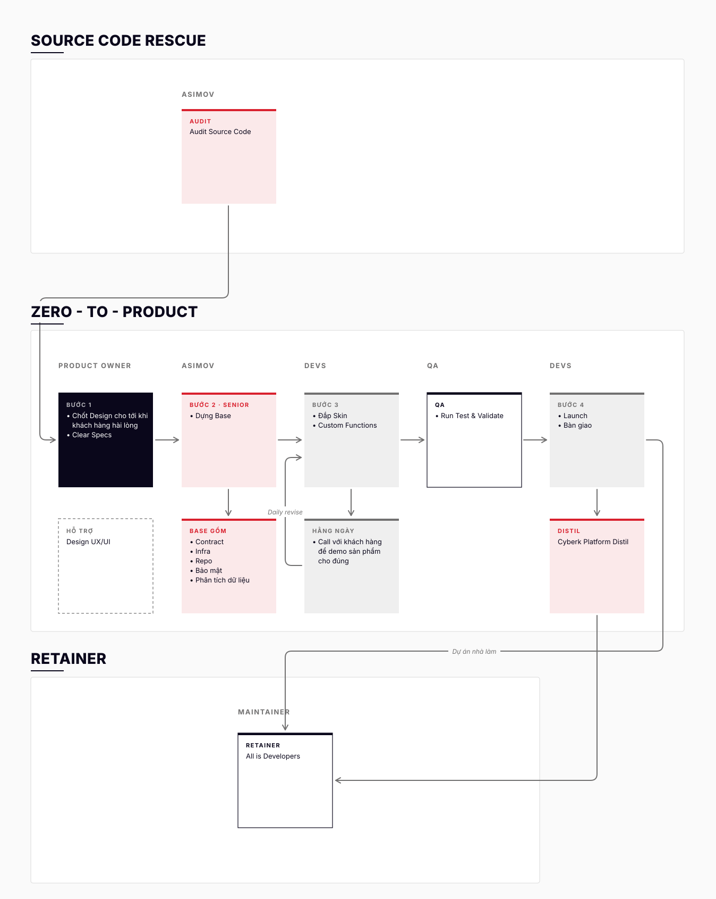

# Vận hành một dự án từ ý tưởng tới Retainer

**Người chịu trách nhiệm:** Anderson
**Cập nhật lần cuối:** 2026-11-02
**Trạng thái:** Nháp

## Tại sao có trang này

Một dự án Zero to Product đi qua tay nhiều nhóm: PO, Design, Team Asimov, Devs, QA, rồi Maintainer. Mỗi nhóm thường chỉ nhìn thấy phần việc của mình, nên dễ giao thiếu cho nhóm sau hoặc làm lại việc nhóm trước đã làm. Trang này vẽ toàn bộ đường đi trên một sơ đồ, để ai cũng biết mình đứng ở đâu, nhận gì từ ai, và giao gì cho ai.

## Khi nào áp dụng (Trigger)

- Khách ký Zero to Product (có ý tưởng, chưa có code), hoặc
- Khách đã có source code và đi qua Source Code Rescue trước, hoặc
- Cyberk bắt đầu một dự án nhà làm (sản phẩm nội bộ).

---

## Luồng chính

Sơ đồ vẽ lại từ bản gốc của Anderson (02/11/2026), giữ nguyên bố cục: ba khu xếp dọc, Zero to Product chia theo cột người làm. Màu theo Cyberk Guideline (#0A071B, #717070, #D9212E, nền trắng; font Satoshi): ô navy là PO, ô đỏ nhạt có vạch đỏ là Team Asimov, ô xám là Devs, ô trắng viền navy là QA và Maintainer, ô nét đứt là Design (vai trò hỗ trợ).

> Sửa sơ đồ: mở `service-overview.svg` bằng trình soạn thảo text. Mỗi ô là một `<rect>` kèm `<text>`, mỗi mũi tên là một `<path class="edge">`. Không dùng Mermaid ở đây vì Mermaid tự sắp xếp lại vị trí các ô và vẽ mũi tên chéo, làm mất bố cục gốc.

---

## Vai trò & trách nhiệm

| Vai trò | Chịu trách nhiệm gì |
|---------|---------------------|
| **PO** (Product Owner) | Đầu mối duy nhất với khách từ đầu tới cuối dự án. Dẫn Bước 1: chốt design và viết clear specs. Có mặt trong các buổi demo hằng ngày ở Bước 3. Khách gọi người này là PO, không gọi Product Lead |
| **Design UX/UI** | Hỗ trợ PO ở Bước 1: làm wireframe, UI, sửa tới khi khách hài lòng |
| **Team Asimov** | Team phát triển Asimov, nền tảng AI-native của Cyberk để làm phần mềm từ đầu tới cuối. Team dùng chính Asimov để audit source code, dựng base (Bước 2), bảo trì. Đây là nhóm có kinh nghiệm nhất của Cyberk |
| **Devs** | Bước 3: đắp skin, làm custom functions trên base của Team Asimov, demo cho khách mỗi ngày. Bước 4: launch và bàn giao |
| **QA** | Run test & validate trước khi launch |
| **Maintainer** | Bảo trì và phát triển tiếp ở giai đoạn Retainer. Mọi developer đều có thể là Maintainer |

---

## Các chặng

| # | Chặng | Ai làm | Đầu vào | Việc chính | Đầu ra (giao cho chặng sau) | Thời gian |
|---|-------|--------|---------|------------|------------------------------|-----------|
| 0 | **Source Code Rescue** *(chỉ khi khách đã có code)* | Team Asimov | Source code của khách | Audit source code | Báo cáo audit, dùng làm đầu vào cho Bước 1 | Theo gói Source Code Rescue |
| 1 | **Chốt design & specs** | PO, có Design UX/UI hỗ trợ | Ý tưởng của khách, hoặc báo cáo audit | Làm design và sửa tới khi khách hài lòng. Viết clear specs | Design đã được khách duyệt, specs rõ ràng | Thường khoảng 1 tuần. Nhanh hay chậm tuỳ việc chốt specs |
| 2 | **Dựng base** | Team Asimov (Senior) | Design + specs | Dựng base: Contract, Infra, Repo, Bảo mật, Phân tích dữ liệu | Base chạy được, repo và hạ tầng sẵn sàng cho Devs | *(cần bổ sung)* |
| 3 | **Đắp skin & custom functions** | Devs | Base + design + specs | Đắp skin theo design, làm các tính năng riêng của dự án. Call với khách mỗi ngày để demo, nhận góp ý, sửa ngay hôm sau (Daily revise) | Sản phẩm đủ tính năng theo specs | *(cần bổ sung)* |
| 4 | **QA** | QA | Sản phẩm từ Bước 3 | Run test & validate | Kết quả test, sản phẩm đủ điều kiện launch | *(cần bổ sung)* |
| 5 | **Launch & bàn giao** | Devs | Sản phẩm đã qua QA | Launch, bàn giao cho khách | Sản phẩm đang chạy, khách nhận bàn giao | Theo [quy trình bàn giao](../../05-product-owner/po-handover/handover-process.md) |
| 6 | **Cyberk Platform Distil** | *(cần xác nhận: theo màu sơ đồ là Team Asimov)* | Những gì học được từ dự án vừa làm | Viết thêm code template dùng chung, linh hoạt hơn, cho loại dự án vừa làm. Ví dụ: làm xong một launchpad thì có template launchpad cho dự án mới | Template mới trong Cyberk Platform | Sau Bước 4 |
| 7 | **Retainer** | Maintainer | Sản phẩm đã launch; template trong Cyberk Platform | Bảo trì, phát triển tiếp | — | Lâu dài |

### Vì sao có bước Distil

Mỗi dự án để lại một bài học về một loại sản phẩm. Nếu không rút bài học thành code dùng lại được, dự án sau cùng loại lại phải làm từ đầu. Distil biến bài học đó thành template. Khách đến sau có lợi thế: Bước 2 của họ ngắn hơn, vì base đã có sẵn nhiều phần.

### Ai đi vào Retainer

- **Dự án nhà làm** (sản phẩm nội bộ của Cyberk) đi thẳng vào Retainer sau khi launch.
- **Code template từ Distil** cũng được bảo trì ở Retainer, để luôn dùng được cho dự án tiếp theo.
- Dự án của khách sau khi bàn giao: có 30 ngày bảo trì miễn phí theo [chính sách bảo trì](../../05-product-owner/po-handover/maintenance-policy-reference.md). Cách chuyển tiếp sang Retainer *(cần bổ sung)*.

---

## Quy tắc cứng (không được vi phạm) + lý do

| Quy tắc | Lý do |
|---------|-------|
| Distil viết template mới, **không dùng code của khách** | Code là tài sản của khách: khách sở hữu toàn bộ code, cấu hình hạ tầng và file thiết kế. Template phải là code Cyberk tự viết, dùng chung được, không mang logic riêng của một khách nào |
| PO là đầu mối duy nhất với khách | Khách chỉ cần nói chuyện với một người. Nhiều đầu mối thì thông tin bị lệch giữa các nhóm |
| Không sang Bước 2 khi design và specs chưa được khách duyệt | Base được dựng theo specs. Specs đổi sau khi dựng base thì Team Asimov phải làm lại |
| Bước 3 phải có call demo với khách mỗi ngày | Khách thấy sản phẩm chạy mỗi ngày, nên một hướng đi sai chỉ tốn một ngày làm việc. Xem [Sprint một tuần, phản hồi mỗi ngày](../../01-cyberk-way/5.1-sprint-mot-ngay.md) |
| Không launch khi QA chưa validate | Lỗi khách gặp trên production làm mất niềm tin nhanh hơn mọi chậm trễ |

---

## Ngoại lệ & Escalation

| Tình huống | Hành động |
|-----------|----------|
| Khách cần làm nhanh, chưa xong giấy tờ | Làm design (Bước 1) và giấy tờ hợp đồng cùng lúc. Kick-off không cần đợi PRD |
| Khách đã có source code | Đi qua Source Code Rescue trước. Báo cáo audit là đầu vào của Bước 1 |
| Bước 1 kéo dài quá 1 tuần vì specs chưa chốt được | PO báo Anderson, kèm danh sách những điểm còn chưa chốt |
| Khách đổi yêu cầu giữa Bước 3 | Ghi nhận và đánh giá impact theo [Viết BRD khi phát sinh yêu cầu mới](../../04-developer/dev-write-brd/dev-write-brd-process.md). Không hứa ngay tại buổi call |

---

## Checklist chuyển chặng

- [ ] Bước 1 → 2: khách đã duyệt design; specs đã viết xong và gửi cho Team Asimov
- [ ] Bước 2 → 3: base chạy được; Devs đã có quyền vào repo và hạ tầng
- [ ] Bước 3 → QA: đủ tính năng theo specs; khách đã xem demo phần cuối
- [ ] QA → Bước 4: QA đã validate xong
- [ ] Bước 4 → Distil: đã bàn giao cho khách; đã ghi lại phần nào nên thành template

---

## Liên kết

- Mô tả dịch vụ để bán (giá, gói, FAQ): `marketing/services/zero-to-product/zero-to-product.md`, `marketing/services/source-code-rescue/source-code-rescue.md`
- Tài liệu theo role: [Product Owner](../../05-product-owner/README.md) · [Developer](../../04-developer/README.md) · [QA](../../06-qa/README.md)
- Kick-off với khách: [kick-off-process.md](../../05-product-owner/po-kick-off/kick-off-process.md)
- Bàn giao: [handover-process.md](../../05-product-owner/po-handover/handover-process.md)
- Triết lý phản hồi hằng ngày: [5.1-sprint-mot-ngay.md](../../01-cyberk-way/5.1-sprint-mot-ngay.md)
