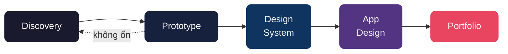

# Quy trình thiết kế — Hướng dẫn cho Designer

**Người chịu trách nhiệm:** Design Lead
**Cập nhật lần cuối:** 2026-11-15
**Trạng thái:** Nháp

## Tại sao có trang này

Designer cần một quy trình rõ ràng để biết **làm gì, làm đến đâu là đủ, và bàn giao cái gì** ở mỗi giai đoạn. Trang này là bản nội bộ chi tiết — mở rộng từ [quy trình 4 bước gửi khách hàng](../client-documents/design-process-client-vi.md), thêm bước thứ 5 (Portfolio) và đặc biệt nhấn mạnh việc **lưu đủ bằng chứng công việc** xuyên suốt quy trình.

### Triết lý cốt lõi: Lưu bằng chứng — Show the work

> **Mọi quyết định thiết kế đều phải có dấu vết.**
> Không chỉ deliverable cuối cùng — mà cả quá trình nghiên cứu, suy nghĩ, và lý do đằng sau mỗi lựa chọn.

Tại sao?
- **PO dễ trình bày cho khách hàng** — không phải nhớ trong đầu hay giải thích miệng
- **Khách hàng thấy được effort** — thiết kế không phải "vẽ vài cái màn hình", mà là cả quá trình nghiên cứu, so sánh, thử nghiệm
- **Designer mới tiếp quản được** — khi có người thay, họ hiểu ngay vì sao thiết kế như thế
- **Behance dựng nhanh** — bằng chứng đã lưu sẵn, chỉ cần chọn và trình bày

## Khi nào áp dụng (Trigger)

- Bắt đầu thiết kế cho một dự án mới (app, web, dashboard...)
- Thiết kế lại (redesign) một sản phẩm đã có

---

## Luồng chính

### ⏱ Lưu ý về Timeline

> **6 working days đầu tiên** = hoàn thành thiết kế cơ bản cho 1 dự án (Discovery → Prototype → Design System → App Design).

Điều này **không** có nghĩa là design đã hoàn thành 100% công việc — cũng không nhất thiết phải hoàn thành 100%. Mục đích là designer dành **6 ngày đầu tiên tập trung vào những việc quan trọng nhất**, tránh block công việc của Dev (vì Dev cũng làm việc song song với Designer để đảm bảo dự án deliver nhanh).

**Sau 6 ngày đầu tiên**, designer sẽ:
- Chỉnh sửa design UX/UI theo feedback của khách hàng
- Hoàn thành Portfolio (5 working days tiếp theo)

| Giai đoạn | Bước | Timeline |
|-----------|------|----------|
| **6 ngày đầu** | Discovery → Prototype → Design System → App Design | 1 + 1 + 1 + 3 ngày |
| **5 ngày tiếp** | Chỉnh sửa theo feedback + Portfolio | 5 ngày |

---

## Vai trò & trách nhiệm

| Vai trò | Chịu trách nhiệm gì |
|---------|---------------------|
| **Designer** | Thực hiện thiết kế, lưu bằng chứng công việc vào Figma, chuẩn bị deliverables, trình bày cho stakeholder |
| **Design Lead** | Review chất lượng, duyệt nội bộ trước khi gửi khách, mentor cho designer |
| **PO / PM** | Cung cấp requirement, đại diện khách hàng duyệt, quản lý timeline |
| **Dev** | Tham gia walkthrough kỹ thuật ở Discovery (wireframe) và nhận bàn giao ở App Design |

---

## Các bước

### Discovery

> *Đúng vấn đề, đúng luồng*

| # | Việc làm | Ai làm | Đầu ra | Bằng chứng cần lưu |
|---|----------|--------|--------|-------------------|
| 1.1 | Nghiên cứu đối thủ & thị trường | Designer | Bảng so sánh đối thủ | **Chụp ảnh màn hình các app reference** → lưu vào page "Research" trong Figma, ghi chú điểm hay/dở |
| 1.2 | Nghiên cứu người dùng | Designer + PO | Chân dung người dùng (User Persona) | Ghi chú phỏng vấn, insight từ data |
| 1.3 | Vẽ User Flow + Wireframe | Designer | Sơ đồ luồng sử dụng kèm wireframe từng màn hình | Flow phải cover luồng chính + các nhánh lỗi |

**📦 Output (đầu ra):**
- Danh sách các sản phẩm tương tự, tham khảo — kèm link và screenshot (để khách hàng dễ nhìn)
- 1 bản mô tả chân dung người dùng bằng tiếng Anh
- 1 User-flow wireframe để confirm với khách hàng đúng luồng từ buổi họp đầu tiên

**⏱ Timeline:** 1 ngày
---

### Prototype

> *Thử phong cách trên vài màn hình*

| # | Việc làm | Ai làm | Đầu ra | Bằng chứng cần lưu |
|---|----------|--------|--------|-------------------|
| 2.1 | Tạo Moodboard | Designer | Bảng định hướng phong cách (màu, chữ, hình ảnh) | **Lưu references vào page "Moodboard"** trong Figma — ghi chú tại sao chọn mỗi reference |
| 2.2 | Thiết kế 2–4 Key Mockup | Designer | Màn hình mẫu hoàn chỉnh | Nếu có nhiều phương án → **lưu tất cả phương án**, ghi lý do chọn phương án cuối |
| 2.3 | Kiểm tra trên thiết bị thật | Designer | Ảnh chụp / ghi chú | Chụp ảnh điện thoại đang hiển thị mockup (nếu có vấn đề) |
| 2.4 | Chuẩn bị presentation cho khách | Designer + PO | Slide / file trình bày | **Viết lý do thiết kế bên cạnh mỗi mockup** — tại sao chọn style này, tại sao bố cục như thế |

**📦 Output (đầu ra):**
- Moodboard kèm lý do
- 3 lựa chọn mockup kèm lý do, và suggestion của designer để khách hàng dễ chọn lựa

**⏱ Timeline:** 1 ngày
---

### Design System

> *Chọn Design System có sẵn, xây component quan trọng*

| # | Việc làm | Ai làm | Đầu ra | Bằng chứng cần lưu |
|---|----------|--------|--------|-------------------|
| 3.1 | Chọn Design System có sẵn phù hợp với dự án | Designer | Lựa chọn Design System kèm lý do | Ghi chú tại sao chọn system này, so sánh với các lựa chọn khác |
| 3.2 | Xây dựng các components quan trọng từ system đã chọn | Designer | Bộ components dùng lại | — |
| 3.3 | Stress test Design System | Designer | Kết quả kiểm tra | Ghi chú các lỗi tìm thấy và cách sửa |

> Chi tiết các phép thử: xem [Design Validation Checklist — STEP 04](../client-documents/design-validation-checklist.md#step-04--design-system--kiểm-tra-độ-bền-của-quy-chuẩn)

**📦 Output (đầu ra):**
- Lựa chọn Design System kèm lý do
- File Design System trong Figma (components quan trọng)
- Kết quả stress test (contrast, resize, font scale, touch target, dấu tiếng Việt)

**⏱ Timeline:** 1 ngày
---

### App Design

> *Không bỏ sót màn hình nào*

| # | Việc làm | Ai làm | Đầu ra | Bằng chứng cần lưu |
|---|----------|--------|--------|-------------------|
| 4.1 | Thiết kế toàn bộ màn hình còn lại | Designer | Mọi màn hình của sản phẩm | — |
| 4.2 | Thiết kế Edge Cases | Designer | Empty, Loading, Error, Success, Disabled cho mỗi màn hình | **Checklist trạng thái** cho mỗi màn hình |
| 4.3 | Stress test nội dung | Designer | Kết quả kiểm tra | Ghi chú các trường hợp tên dài, số lớn, danh sách rỗng... |
| 4.4 | Prototype end-to-end | Designer | Prototype hoàn chỉnh bấm được từ đầu đến cuối | — |
| 4.5 | Kiểm tra trên thiết bị thật | Designer | Ghi chú vấn đề (nếu có) | — |
| 4.6 | Chuẩn bị Handoff | Designer | File Figma sạch, sẵn sàng cho Dev | Ghi chú spacing, interaction, animation bên cạnh mỗi màn hình |

> Chi tiết các phép thử: xem [Design Validation Checklist — STEP 05](../client-documents/design-validation-checklist.md#step-05--detailed-ui--kiểm-tra-độ-phủ--tính-nhất-quán)

**📦 Output (đầu ra):**
- Toàn bộ màn hình (bao gồm edge cases)
- Prototype end-to-end
- File Figma sạch, sẵn sàng handoff cho Dev

**⏱ Timeline:** 3 ngày

---

### Portfolio

> *Dựng portfolio — mỗi dự án là một cơ hội marketing cho Cyberk*

| # | Việc làm | Ai làm | Đầu ra | Ghi chú |
|---|----------|--------|--------|---------|
| 5.1 | Chọn highlights từ bằng chứng đã lưu | Designer | Danh sách ảnh + nội dung sẽ dùng | Lấy từ page Research, Moodboard, các mockup đẹp nhất |
| 5.2 | Viết nội dung case study | Designer | Bài viết ngắn gọn | Giới thiệu dự án, bài toán, quá trình, kết quả |
| 5.3 | Dựng layout Behance | Designer | File Figma hoặc trực tiếp trên Behance | — |
| 5.4 | Review nội bộ | Design Lead | Feedback | — |
| 5.5 | Publish lên Behance | Designer | Bài case study đã publish | Thêm vào profile Cyberk |

**Nội dung case study tiêu chuẩn:**
1. **Cover / Thumbnail** — ấn tượng, đại diện cho dự án
2. **Giới thiệu** — bài toán của khách hàng, mục tiêu
3. **Quá trình** — research → wireframe → UI (lấy từ bằng chứng đã lưu ở Discovery → App Design)
4. **Highlight mockups** — 5–10 màn hình đẹp nhất
5. **Kết quả / Impact** — số liệu nếu có, hoặc đánh giá từ khách hàng

**📦 Output (đầu ra):**
- Bài Behance case study đã publish
- Ảnh thumbnail cho portfolio tổng hợp

**⏱ Timeline:** 5 ngày

---

## Quy tắc cứng (không được vi phạm) + lý do

| # | Quy tắc | Lý do |
|---|---------|-------|
| 1 | **Không skip bước, không nhảy cóc** | Mỗi bước xây trên nền bước trước — skip wireframe để làm UI trực tiếp sẽ phải sửa lại luồng khi đã tốn công lên màu |
| 2 | **Lưu bằng chứng công việc vào Figma ngay khi làm** | Không lưu = mất effort, PO không trình bày được cho khách, Behance không có gì để dựng |
| 3 | **Viết lý do bên cạnh mỗi quyết định thiết kế** | PO cần lý do để trình bày cho khách. Khách hàng trả tiền cho quá trình suy nghĩ, không chỉ cho "mấy cái hình" |
| 4 | **Edge cases (empty, loading, error) phải được thiết kế** | Dev tự đoán = mỗi dev làm khác nhau = UX không nhất quán |
| 5 | **Mỗi dự án hoàn tất phải dựng Portfolio (Behance case study)** | Tích lũy portfolio cho Cyberk — không dựng = mất cơ hội marketing. Bằng chứng đã lưu sẵn, chỉ cần chọn và dựng |

---

## Liên kết

- [Quy trình 4 bước — Bản gửi khách hàng (VI)](../client-documents/design-process-client-vi.md)
- [Quy trình 4 bước — Bản gửi khách hàng (EN)](../client-documents/design-process-client-en.html)
- [Design Validation Checklist](../client-documents/design-validation-checklist.md)
- [Cẩm nang chi tiết từng bước](./design-process-handbook.md)
